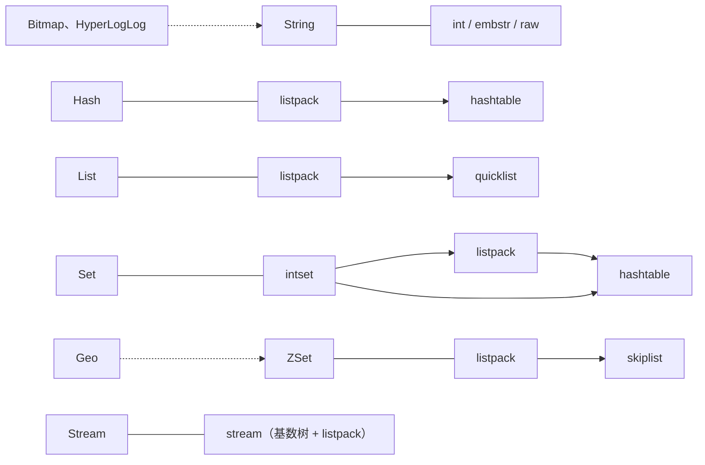

往一个 Redis Hash 里写 512 个短字段，`MEMORY USAGE` 显示它占 4400 字节。再写第 513 个，占用变成 22929 字节。只多了一个字段，内存涨了五倍多。

```
> HLEN h
512
> MEMORY USAGE h
4400
> HSET h f513 513
1
> MEMORY USAGE h
22929
```

这个“五倍”不算巧合。Redis 官方的内存优化文档说，小数据的特殊存法最多能省 10 倍内存，平均省 5 倍。开头这个 Hash，就是在第 513 个字段上丢掉了这份优惠。

学 Redis 命令时，记住“Hash 存对象、ZSet 做排行榜”就能干活，但这个现象靠命令解释不了。答案在类型下面那一层：Redis 对外提供 String、Hash、ZSet 这些**类型**，它们在内存里怎么摆放是另一回事，叫**编码**（encoding）。同一个类型有好几种编码，Redis 按数据大小自动切换。第 513 个字段越过了一条线，Hash 换了一种存法。

> [!note] 版本与范围
> 文中命令都在 Docker 里的 Redis 8.10.2（`redis:8` 镜像，默认配置）上跑过，常量和默认值对照了同一版本的源码。阈值和字节数属于实现细节，换个版本可能不同。本文只讲 String、Hash、List、Set、ZSet、Stream 这几种经典类型，以及借用它们的 Bitmap、HyperLogLog、Geo；Redis 8 里新增的 Vector Set，以及镜像自带的 JSON、TimeSeries 等，不在本文范围内。

## 两条约束：数据全在内存里，命令只有一个线程执行

Redis 的数据全部放在内存里。内存比磁盘贵得多，所以“同样的数据少占一点”一直是 Redis 设计里的大事。

命令则由一个线程一条一条地执行。官方文档的说法是 Redis “基本上是单线程的”（mostly single threaded）：后台线程负责刷盘、释放内存；从 6.0 起还可以开 I/O 线程分担网络收发（8.0 重写了这部分实现，默认不开）。但**执行命令**始终只有主线程一个。

单线程带来两个好处。一是数据结构不用加锁，实现简单。二是每条命令天然原子，`INCR` 执行到一半，不会有别的命令插进来。代价是一条命令慢，所有人都得等。我用一个故意空转约 1.8 秒的 Lua 脚本试了一下：脚本开始 0.5 秒后，另一个客户端发 `PING`，等了 1.25 秒才收到 `PONG`。`PING` 本身几乎不花时间，这 1.25 秒全在排队。

这两条约束给数据结构提了两个要求：省内存，并且每条命令都要快。两者经常互相拉扯。后面看每种类型，都可以问同一个问题：它拿什么换了什么。

## 类型和编码：对外一个样子，内部几种存法

`TYPE` 返回类型，`OBJECT ENCODING` 返回编码：

```
> SET n 12345
OK
> TYPE n
string
> OBJECT ENCODING n
int
> HSET user:1 name alice age 30
2
> TYPE user:1
hash
> OBJECT ENCODING user:1
listpack
```

类型决定能对这个 key 用哪些命令；编码不影响命令的结果，只影响内存和速度。官方文档说这种切换“对用户和 API 完全透明”，是一笔 CPU 和内存之间的交换。

下面是实测到的各类型编码：



实线箭头是数据变大（或 Set 里加入非整数）后的转换方向。String 的三种编码按值的内容和长度来选，没有固定的先后。虚线表示“借用”：Bitmap 和 HyperLogLog 是 String 上的一组命令，Geo 是 ZSet 上的一组命令，它们不是独立的类型，`TYPE` 分别返回 `string` 和 `zset`。

## 小数据为什么换一种存法

哈希表、跳表、链表这类结构由许多节点组成，节点之间用指针相连。数据多的时候它们查得快，但每个节点要单独分配内存，还要存指针。Redis 作者 Salvatore Sanfilippo（antirez）等人写的 listpack 规格文档里有个估计：元素平均很小时，这些元数据轻易就占到内存的 50%。

元素少的时候，可以把所有元素一个挨一个编码进一整块连续内存，不要指针。这就是 **listpack**。它的格式很朴素：开头 6 字节记总长度和元素个数，然后是一串元素，最后 1 字节结束标记。每个元素记着自己的长度，所以既能从前往后走，也能从后往前走。

代价是查找只能逐个扫描。规格文档给了两条理由说明这不要紧：元素个数被阈值限制在一个小常数以内，复杂度并没有变；扫描的是一段连续内存，对 CPU 缓存很友好，常数时间足以补偿全量扫描的开销。

Hash、List、Set、ZSet 在数据小的时候都用 listpack。超过阈值，就换成各自的“正式”结构。表里和后文的 O(1)、O(log N)、O(N) 是复杂度记号，描述元素个数 N 变大时操作耗时怎么增长：O(1) 基本不变，O(log N) 增长得很慢（N 从一千涨到一百万，大约只多一倍），O(N) 跟着 N 成正比变长。

| 结构 | 是什么 | 谁用 |
| --- | --- | --- |
| hashtable | 哈希表，按键查找平均 O(1) | Hash、Set |
| skiplist | 跳表加哈希表，有序，增删和范围查找 O(log N) | ZSet |
| quicklist | 双向链表，每个节点是一个 listpack | List |
| intset | 排好序的整数数组，二分查找 | 只含整数的小 Set |

阈值是配置项，默认值如下：

| 配置项 | 默认值 | 含义 |
| --- | --- | --- |
| `hash-max-listpack-entries` / `-value` | 512 / 64 | Hash 字段数超过 512，或任一字段名、值超过 64 字节，转 hashtable |
| `set-max-intset-entries` | 512 | 全整数 Set 超过 512 个成员，不再用 intset |
| `set-max-listpack-entries` / `-value` | 128 / 64 | Set 超过 128 个成员或任一成员超过 64 字节，转 hashtable |
| `zset-max-listpack-entries` / `-value` | 128 / 64 | ZSet 超过 128 个成员或任一成员超过 64 字节，转 skiplist |
| `list-max-listpack-size` | -2 | List 的单个 listpack 节点最大 8KB |

开头那个 Hash 就是越过了 512 这条线：前 512 个字段挤在一块 listpack 里，第 513 个字段一来，Redis 建了一张哈希表，每个字段都有了自己的节点和指针，内存从 4400 字节涨到 22929 字节。

这里有三件容易忽略的事。

第一，**阈值可以调，但调大是拿 CPU 换内存。** 阈值越大，listpack 越长，每次查找扫得越久。官方文档建议调之前先做基准测试。

第二，**转换大多是单向的。** 把那个 513 个字段的 Hash 删到只剩 1 个字段，编码仍然是 hashtable；ZSet 也一样。List 例外，它会转回 listpack，但要等缩小到限制的一半以下，源码注释说这是为了避免在阈值附近反复增删时来回转换。

第三，**网上常说的 ziplist 已经被 listpack 取代了。** Redis 7.0 的发布说明写着“Replace ziplist with listpack in Hash, List, Zset”；7.2 又让小 List 和小 Set 也直接用 listpack，此前小 List 是只有一个节点的 quicklist，小 Set 只有 intset 和 hashtable 两种编码。所以“小 Hash 用 ziplist”“Set 只有两种编码”这些说法，放在新版本上都过时了。换掉 ziplist 的原因写在 listpack 规格里：ziplist 的每个元素要记录前一个元素的长度，这个字段占 1 或 5 字节。在中间插入一个元素，后面元素的这个字段可能从 1 字节变成 5 字节，变长又影响下一个元素，一路传下去，这叫连锁更新，规格文档称它是 ziplist 代码复杂的主要来源。listpack 改成每个元素只记自己的长度，问题就没了。旧的配置名 `hash-max-ziplist-entries` 现在仍可作为别名使用。

官方内存优化文档还讲了一个利用 listpack 的技巧：大量小 key 值对，与其每个都占一个顶层 key，不如按 ID 分桶装进 Hash。比如把 `object:1234` 拆成 key `object:12`、字段 `34`，每个 Hash 大约 100 个字段，始终处在 listpack 的范围内。代价是这些“key”不能再单独用 `TYPE`、`SCAN` 这类针对顶层 key 的命令操作；想给它们各自设过期时间，要用 7.4 起才有的字段级过期，后面 Hash 一节会讲到。

## String：最基础的类型，三种编码

String 存一串字节，可以是文本、序列化后的 JSON，也可以是图片。它是二进制安全的，因为 Redis 的字符串头部记录了长度，不靠结尾的 `\0` 判断结束。单个值默认最大 512MB。

它解决的问题最直接：缓存一整段内容、做计数器、做简单的锁。`SET lock tok NX EX 30` 一条命令完成“不存在才写入，并设置 30 秒过期”。不过在主从部署下，主节点挂掉、从节点顶上的那一刻，这把锁可能失效，文末讲持久化和复制时再细说。

计数器为什么要用 `INCR`，而不是先 `GET` 再 `SET`？我做过一个对照：20 个客户端各对同一个计数做 20 次“先 `GET`、加一、再 `SET`”，最后结果是 43，大部分更新互相覆盖了；换成每次直接 `INCR`，结果是 400，一次不少。区别在于 `INCR` 把“读、改、写”放进了一条命令，而单线程保证一条命令不会被打断。后面会看到的 `HINCRBY`、`ZINCRBY`，存在的意义也在这里。

String 有三种编码：

- **int**：值能解析成 64 位有符号整数时，直接把整数存进对象里原本放指针的位置，不再另外分配内存。
- **embstr**：短字符串。对象头和内容放在同一块内存里，一次分配完成。
- **raw**：其余情况。对象头和内容各占一块内存，对象里存一个指针。

小数、带前导零的数字串（`007`）、超出 64 位范围的数，都按字符串存。

embstr 和 raw 的分界，流传最广的说法是“44 字节”：对象头 16 字节，加上字符串头和结尾的 `\0`，44 字节的内容刚好凑满内存分配器 64 字节的那一档。源码里也还留着 `OBJ_ENCODING_EMBSTR_SIZE_LIMIT 44` 这个常量。但从 Redis 8.2 起，存进数据库的对象把 key 也嵌进了同一块内存，判断条件变成“对象头、key、value 加起来不超过一个缓存行”。`src/object.c` 的 `kvobjSet` 里是这样算的：

```c
size_t size = sizeof(kvobj);
size += (key != NULL) * (sdslen(key) + 3);
size += 4 + len;
if (size <= CACHE_LINE_SIZE) { /* embstr */ }
```

缓存行在 `config.h` 里定义为 64 字节（只有 Apple 的 arm64 平台是 128），对象头 16 字节，所以条件化简下来是 **key 长度加 value 长度不超过 41 字节**。我用不同长度的 key 逐字节加长 value，转换点和算式一致：

```
keylen=1   vallen=40 -> embstr   vallen=41 -> raw
keylen=8   vallen=33 -> embstr   vallen=34 -> raw
keylen=32  vallen=9  -> embstr   vallen=10 -> raw
```

这个变化对小 key 很实在。官方的 8.2 发布博客说，把 key、短值和过期时间放进同一次分配后，短字符串的内存降了 25% 到 37%。反过来，项目里常见的 `user:profile:123456` 这种 key 自己就有 19 个字节，留给 embstr 的空间只剩二十来字节。

编码还会随修改变化。源码注释把 embstr 称作“不可修改的字符串”，对它 `APPEND` 会变成 raw，哪怕结果很短；int 被 `APPEND` 后也变成 raw，再 `INCR` 又回到 int。String 的取舍就在这里：能少一次内存分配就少一次，代价是短字符串不能原地修改，一改就得换一种存法。

## Hash：只改一个字段，不用读写整个对象

把一个对象存成 JSON 放进 String，改一个字段就得读出整段、反序列化、改、再写回去；两个客户端同时这么做，后写的会覆盖先写的，就是上一节 `GET` 再 `SET` 的那个问题。Hash 把对象的每个属性存成一个字段，`HSET`、`HINCRBY` 只动一个字段，而且是一条原子命令。

```
> HSET user:1 name alice age 30
2
> HINCRBY user:1 age 1
31
```

编码是 listpack 或 hashtable，转换条件前面讲过。Redis 7.4 起可以给单个字段设过期时间（`HEXPIRE`），用了这个功能的小 Hash，编码显示为 `listpackex`。官方内存优化文档里还有一句“Hash 字段不能单独设置过期时间”，那是 7.4 之前写的，已经过时。

Hash 最常见的风险来自单线程。大多数 Hash 命令是 O(1)，`HGETALL`、`HKEYS`、`HVALS` 是 O(N)。在几十万个字段的 Hash 上执行 `HGETALL`，主线程要把它们全部编码进回复，这段时间所有客户端都在排队。字段多的 Hash 用 `HSCAN` 分批取。

## List：两头进出的队列

List 是按插入顺序排列的字符串序列，两头都能推入和弹出，访问头尾 O(1)，按下标访问中间元素 O(N)。

它解决两类问题。一是保留“最新的 N 条”：`LPUSH` 之后跟一个 `LTRIM`。二是简单的生产者消费者队列：消费者用 `BRPOP` 阻塞等待，不必轮询。

小 List 是一个 listpack，大了以后是 **quicklist**：一条双向链表，每个节点是一个最大 8KB 的 listpack。纯链表两头操作快，但每个元素都要付一份指针和分配的开销；纯 listpack 省内存，但在一整块大内存里插入、删除要搬动大量字节。quicklist 两头都取一点：链表负责两头的灵活，节点内部用 listpack 省空间。实测每个元素 10 字节时，推到第 683 个，List 从 listpack 转成 quicklist；缩回 340 个时转回 listpack。

用 List 做队列有一个要想清楚的边界：`BRPOP` 弹出消息后，它就从 List 里删掉了。消费者拿到消息后崩溃，这条消息就没了。官方文档给的补救是“可靠队列”模式：用 `LMOVE` / `BLMOVE` 把消息原子地移到一个“处理中”列表，处理完再删掉，相当于手动确认。但它没有消费组，也没有现成的办法把崩溃消费者手里的消息转给别人。需要这些时，应该用后面讲的 Stream。

## Set：不重复的集合

Set 是无序、不重复的字符串集合。判断成员是否存在是 O(1)，还能直接做交集、并集、差集，适合标签、去重、共同好友这类问题。

Set 有三种编码，起点取决于成员是不是整数。全是整数时用 **intset**，一个排好序的整数数组，按需要选 16、32 或 64 位的元素宽度，用二分查找定位。加进一个非整数成员，集合还小就转 listpack，否则直接转 hashtable。

这里的内存差距比 Hash 还大：512 个整数的 intset 占 1053 字节，加入第 513 个后变成 hashtable，占 18934 字节，翻了十几倍。这一跳没有经过 listpack，因为 513 已经超过了 listpack 的 128 上限。

和 Hash 一样，大 Set 上的 `SMEMBERS` 是 O(N) 且一次返回全部，几十万成员时改用 `SSCAN`。集合运算也要留意规模：两个百万级集合做 `SINTER`，会在主线程上实打实地算很久。

## ZSet：两种结构存同一份数据

ZSet（Sorted Set）的每个成员带一个浮点分数，成员不重复，整体按分数排序。分数相同时按成员的字节序排。排行榜是最典型的用法：

```
> ZADD rank 90 alice 85 bob 95 carol
3
> ZRANGE rank 0 1 REV WITHSCORES
carol
95
alice
90
> ZREVRANK rank alice
1
```

小 ZSet 用 listpack，成员和分数交替存放并保持有序。超过 128 个成员或有成员超过 64 字节，就转成 skiplist 编码，实测内存从 944 字节涨到 10804 字节，涨了十倍多。

涨这么多，是因为 skiplist 编码的名字只说了一半。源码 `server.h` 里的 `zset` 结构体同时有一个哈希表和一个跳表。ZSet 要回答两类问题：“alice 多少分”适合哈希表，O(1)；“90 到 100 分之间有谁”“第 10 名是谁”需要有序结构，O(log N)。只用一种，总有一类操作会变慢。两个结构共用同一份成员字符串，不重复存储，但两套索引的节点和指针都得付。这是全文最典型的空间换速度。

> [!note] 源码里一处过时的注释
> `t_zset.c` 文件开头的注释仍写着“元素被加进一个把对象映射到分数的哈希表”，但同一个文件里 `zsetDictType` 的注释是“maps sds to zskiplistNode*”（sds 是 Redis 自己的字符串类型），并设了 `.no_value = 1`：8.10.2 的哈希表里存的是跳表节点，分数在节点里。文件头描述的是旧实现。

**跳表**可以理解成一条有序链表，上面加了几层“快车道”。每个节点插入时随机决定自己有几层，层数越高的节点越少；查找时先在高层大步跳，再逐层下降，期望复杂度 O(log N)。它来自 William Pugh 1990 年的论文《Skip Lists: A Probabilistic Alternative to Balanced Trees》。Redis 的参数在 `server.h` 里：每多一层的概率是 1/4（`ZSKIPLIST_P 0.25`），最多 32 层。源码注释说实现基本照着论文写，改了三处：允许分数重复；比较时除了分数还比较成员；最底层有反向指针，方便 `ZREVRANGE` 从尾往头走。

为什么不用红黑树这类平衡树？antirez 在 2010 年的一条 Hacker News 评论里给过三条理由：

1. 跳表不一定更耗内存，调节层数的概率参数，可以让它比 B 树更省。
2. ZSet 经常被 `ZRANGE`、`ZREVRANGE` 这样当链表遍历，这时跳表的缓存局部性至少不比平衡树差。
3. 跳表更容易实现和调试。他举的例子是，有人提交了一个补丁，在跳表上加了跨度信息，让 `ZRANK` 做到 O(log N)，只改了很少的代码。

要注意，跳表的 O(log N) 是期望值，不是最坏情况保证。层数由随机数决定，严重退化的概率极低，但它和平衡树的保证方式不同。

除了排行榜，官方文档还提到 ZSet 可以做滑动窗口限流：用时间戳当分数，`ZREMRANGEBYSCORE` 删掉窗口外的记录，`ZCARD` 数窗口内的请求数。

## Bitmap：一位数据，占了 12.5MB

先看一个反直觉的结果。只设一位，下标是一亿：

```
> SETBIT sparse 100000000 1
0
> STRLEN sparse
12500001
```

一位数据占了 12.5MB。原因是 Bitmap 不是新结构，而是一组把 String 当作位数组操作的命令。字符串的长度由最大的下标决定，和设了多少位无关。`SETBIT` 的文档还提醒，一次性分配这么大的内存可能让服务器阻塞一段时间，又是单线程的老问题。

反过来，下标连续、密集时它非常省。一个用户一个月的签到用一个 key 记录，第几天签到就把第几位置 1：

```
> SETBIT sign:u1:202610 0 1
0
> SETBIT sign:u1:202610 12 1
0
> BITCOUNT sign:u1:202610
2
> TYPE sign:u1:202610
string
```

一个月 31 天只要 4 个字节。多个 Bitmap 还能做位运算：两天的活跃用户各存一个 Bitmap，位的下标是用户 ID，`BITOP AND` 的结果就是两天都活跃的用户。

所以用 Bitmap 之前，先看下标是怎么分布的。下标上限是 2³² − 1，对应 512MB 的字符串。雪花算法生成的 ID 在 10¹⁸ 量级，根本写不进去：

```
> SETBIT sf 1800000000000000000 1
ERR bit offset is not an integer or out of range
```

更隐蔽的是编号从一亿起步的用户 ID：活跃用户只有几千，Bitmap 却先垫了 12.5MB 的零。遇到这种情况，要么先把 ID 映射成从 0 开始的连续编号，要么换 Set 或 HyperLogLog。

## HyperLogLog：用 12KB 数不重复的个数

统计一个页面有多少独立访客，直接的办法是把访客 ID 放进 Set 再数。问题是 Set 的内存随人数增长，实测 10 万个形如 `u123` 的成员，Set 占约 3.96MB。

HyperLogLog 换了个思路：不存元素本身，只存足够估算个数的统计量。官方文档给的指标是最多用 12KB 内存，标准误差 0.81%。它在 Redis 2.8.9 加入，antirez 当时写了一篇介绍文章《Redis new data structure: the HyperLogLog》。

原理可以这么理解。对每个元素算一个 64 位哈希，哈希值可以看成一串随机的 0 和 1。连续出现很长一串 0 是小概率事件，如果见过低位连续 10 个 0 的哈希（概率约千分之一），大致说明不同的元素已经有上千个了。只看一个最长值偶然性太大，所以 Redis 用哈希的 14 位把元素分到 16384 个“寄存器”里，每个寄存器只记自己见过的最长连续 0 的长度，最后把所有寄存器综合成一个估计值。这套方法来自 Flajolet 等人 2007 年的论文《HyperLogLog: the analysis of a near-optimal cardinality estimation algorithm》。

`src/hyperloglog.c` 里的常量对得上这些数字：`HLL_P 14`，16384 个寄存器，每个 6 位，一共 12288 字节，加 16 字节的头是 12304 字节。元素少时大部分寄存器是 0，Redis 先用压缩的稀疏表示，超过 `hll-sparse-max-bytes`（默认 3000 字节）再转成固定大小的稠密表示。实测加到第 1671 个元素时转换，长度从 2999 字节变成 12304 字节。

准不准？我分别加入 1 千到 100 万个不同元素：

```
real=1000     PFCOUNT=992
real=10000    PFCOUNT=9979
real=100000   PFCOUNT=100425
real=1000000  PFCOUNT=1005024
```

偏差在 0.2% 到 0.8% 之间。整个过程中 `STRLEN` 一直停在 12304 字节，`MEMORY USAGE` 报的是 14KB 左右，多出来的是对象头和内存分配器向上取整的部分。这只是四组数据，0.81% 是标准误差而不是上限，个别情况下偏差可以更大。

它的代价写得很清楚：用精度换内存。它不能告诉你某个元素在不在里面，不能列出元素，也不能删除元素。能做的是合并，`PFMERGE` 把每天的 HyperLogLog 合起来，就是一周的去重访客数。需要精确数字或需要知道具体是谁，还得用 Set 或 Bitmap。

## Geo：存在 ZSet 里的经纬度

Geo 用来存地理位置并按距离查询：

```
> GEOADD shops 116.397128 39.916527 gugong 116.403963 39.915119 wangfujing
2
> GEOSEARCH shops FROMLONLAT 116.40 39.91 BYRADIUS 2 km ASC WITHDIST
wangfujing
0.6623
gugong
0.7661
> TYPE shops
zset
> ZSCORE shops gugong
4069885548668386
```

参数顺序是经度在前、纬度在后。它底下就是一个 ZSet，那个很大的分数是位置编码后的结果。`GEOADD` 的文档解释了做法：用 Geohash（一种把经纬度编码成一串可比较字符的方法）的思路，把经度和纬度的二进制位交错排列，合成一个 52 位整数作为分数。选 52 位是因为 ZSet 的分数是双精度浮点数，52 位以内的整数存进去不会丢精度。

交错之后，地理上相近的点分数往往也相近，查“附近”就变成了按分数范围查，正好是 ZSet 擅长的。但格子边界两侧的两个点，分数可能差得很远，所以查询一个圆或矩形时，Redis 会取覆盖这个形状的中心格子和周围 8 个格子，分别按分数范围取候选点，再把落在形状外的去掉。Geo 没有新增任何结构，只是把二维坐标压成了 ZSet 能排序的一维分数。

这样压缩也有边界：

- 52 位精度有限，存进去的经度 116.397128，`GEOPOS` 读回来是 116.39712899923325。
- 纬度只支持 ±85.05112878 度，靠近两极的点存不了。
- 距离用 Haversine 公式（由两点经纬度算球面距离的公式）计算，把地球当成正球体，文档说最坏误差可能到 0.5%。
- 没有 `GEODEL`，删除位置用 `ZREM`；编码规则也照 ZSet 的来。

## Stream：读过之后消息还在

List 做队列，消息弹出就没了。Stream 是 Redis 5.0 加入的类型，官方文档的定义是“行为像只追加日志的数据结构”。每条消息是一组字段和值，带一个 `毫秒时间戳-序号` 格式的 ID，必须递增，一般用 `*` 让 Redis 生成。

它和 List 的区别在于消息读过之后还留着，并且支持消费组。一个组内，每条消息只投递给其中一个消费者。下面为了看得清楚，手动指定了消息 ID：

```
> XADD orders 1-1 item a
1-1
> XADD orders 2-1 item b
2-1
> XADD orders 3-1 item c
3-1
> XGROUP CREATE orders g 0
OK
> XREADGROUP GROUP g c1 COUNT 2 STREAMS orders >
orders
1-1
item
a
2-1
item
b
> XREADGROUP GROUP g c2 COUNT 2 STREAMS orders >
orders
3-1
item
c
> XPENDING orders g - + 10
1-1
c1
86
1
2-1
c1
86
1
3-1
c2
41
1
```

`c1` 拿走前两条，`c2` 拿到第三条，没有重复。`XPENDING` 列出每条消息在谁手里、空闲了多少毫秒、投递过几次，这时三条都是“已投递、未确认”。

接着对 `1-1` 执行 `XACK`，再看 `XLEN`，仍然是 3。确认不会删除消息，另建一个消费组还能从头读到全部三条。未确认的消息一直记在组里，消费者重启后能重新读到自己没确认的消息；消费者彻底挂了，别人可以用 `XAUTOCLAIM` 把它名下的消息接过来。也就是说，一条消息可能被处理不止一次，官方文档明确说了这一点，消费逻辑需要能承受重复。

Stream 只有一种编码，源码 `t_stream.c` 里的描述是“a radix tree of listpacks”：消息按 ID 顺序打包进一个个 listpack，每个 listpack 挂在一棵基数树（radix tree，一种把键的公共前缀合并存储的有序树）上，键是其中第一条消息的 ID。真正省空间的是 listpack 内部。每个 listpack 开头有一条“主记录”（master entry），记下第一条消息的字段名；后面的消息 ID 只存和这个键的差值，字段名和主记录相同的消息干脆不再存字段名。同一个 Stream 里的消息往往字段相同、ID 相近，所以压得很紧。单个节点默认最多 100 条或 4096 字节，实测 250 条小消息落在 3 个节点里。消费组的状态也存在这个结构里：每个组记着最后投递到的 ID，以及一份未确认消息的表（PEL，pending entries list，待确认列表）。

代价是 Stream 默认无限增长，需要自己用 `XTRIM` 或 `XADD ... MAXLEN` 裁剪。官方文档也特意说明，Redis 的消费组只是借用了 Kafka 的术语，实现上没有关系，它也没有 Kafka 那样的分区概念。消息存得可不可靠，也和其他数据一样，受下一节讲的持久化限制。

## 结构之外：数据放在内存里，要接受哪些事

前面讲的都是同一份数据怎么存得更省。数据全放在内存里，还带来三件绕不开的事：过期的 key 什么时候真的被删，内存满了怎么办，进程挂了数据还在不在。前两件关系到内存会不会被占满，第三件决定一份数据能不能只放在 Redis 里。

**过期的 key 不会准时消失。** Redis 用两种方式删过期 key：访问时检查，过期就当场删（惰性删除）；后台每秒 10 次随机抽查（定期删除）。按 `src/expire.c` 的参数，每轮从一个库里抽 20 个设了过期时间的 key，过期比例超过 10% 就再抽一轮，一个周期最多占用 25% 的时间。

我做了两组对照，都是 2000 个 key 设 1 秒过期。默认配置下，到点后很快只剩 22 个，再过半秒全部清空。关掉定期删除后，过期 1 秒后 `DBSIZE` 仍然是 2000，一个没少，因为只剩惰性删除，没人访问的 key 就一直留着。

所以默认配置下，过期 key 只是晚一点消失，不会一直堆着。要防的是大量 key 在同一秒过期：定期删除发现过期比例高，会一轮接一轮地抽，可能造成卡顿。这也是缓存的过期时间要打散的原因之一。

**内存写满后，默认是报错而不是删数据。** `maxmemory-policy` 的默认值是 `noeviction`，写满后需要更多内存的写命令直接返回 OOM（Out Of Memory，内存不足）错误。把 Redis 当缓存用却没改策略，写满之后所有写入都会失败。可以改成 `allkeys-lru` 这类淘汰策略，LRU 是 Least Recently Used 的缩写，意思是内存不够时，先删最久没被访问的 key。不过 Redis 删的只是近似意义上“最久没访问”的 key：Redis 每次随机抽 5 个 key（`maxmemory-samples`），放进一个 16 个候选的池子，从里面淘汰最旧的。严格的 LRU 要维护一个全局访问顺序，每次访问都要调整，内存和时间都不划算，近似算法就是这里的取舍。

**进程重启和机器故障会丢数据。** 内存里的数据，进程一退出或机器一断电就没了。为了重启后还能找回来，Redis 提供了两种**持久化**方式，也就是把内存里的数据另存一份到磁盘上：一种定期存“整体照片”，一种随时记“流水账”。

第一种叫 **RDB**（Redis Database，快照文件）。Redis 每隔一段时间把内存里的全部数据拍一张快照，存成一个紧凑的二进制文件（默认叫 `dump.rdb`），重启时整个读回来。文件小、恢复快，适合做备份；问题是它只记录拍照那一刻的数据。不带配置文件启动时（Docker 镜像就是这样），默认规则是“1 小时内至少 1 次修改、5 分钟内至少 100 次、1 分钟内至少 10000 次”，满足任一条就拍一次。两次快照之间的写入，宕机时会丢；写入不多的实例，丢掉的可能是将近一小时的数据。

拍快照时，主线程不会停下来自己写文件，而是 fork 出一个子进程：fork 是操作系统复制出一个和当前进程共享内存的“分身”，由分身慢慢把数据写进文件，主线程照常处理命令。但 fork 这一下本身要复制进程的内存映射表，数据越多越慢。官方文档提醒，数据集很大、CPU 又不强时，它可能让 Redis 停顿几毫秒甚至一秒，这一下同样会让所有客户端一起等。

第二种叫 **AOF**（Append Only File，只追加文件）。它不拍照，而是把每一条写命令按顺序追加到一个日志文件末尾，重启时从头重放一遍，把数据恢复出来。日志会越写越长，Redis 会在后台定期把它重写成更短的等价版本。AOF 丢得比 RDB 少，但默认是关的（`appendonly no`）。打开后丢多少，取决于多久做一次 fsync：写文件时，数据往往先停在操作系统的缓存里，fsync 是要求操作系统把它真正写到磁盘上。默认 `appendfsync everysec` 每秒做一次，宕机最多丢大约一秒；改成 `always` 每条写入都做，最安全，代价是写入变慢。两种方式可以同时打开。

持久化防的是进程重启，防不了整台机器坏掉、磁盘一起没了。这要靠**主从复制**：一个主节点负责接收写入，再把数据同步给一个或多个从节点，主节点坏了还有副本。问题是这个同步是异步的：主节点回复 `OK` 时，从节点可能还没收到，主节点此时宕机，这条写入就丢了。哨兵（Sentinel，监控主节点、主节点挂了自动把一个从节点提升为新主节点）和 Cluster（把数据分片到多个主节点上的集群模式）负责的是故障切换，不改变复制是异步的这一点。`WAIT` 命令可以等指定数量的从节点确认收到再返回，官方文档说它能大大降低丢写的概率，但不能让 Redis 变成强一致的存储。

这几条边界合起来，决定了 Redis 里该放什么数据。缓存丢了可以从数据库重建，计数、排行榜、限流丢掉最近一两秒通常也能接受，这些是 Redis 最舒服的位置。订单、余额这类丢一条就出事的数据，不该只放在 Redis 里。

前面讲过的两个用法，也要放回这个背景里看。一是 String 一节的 `SET lock tok NX EX 30`。官方的分布式锁文档举过一个例子：客户端 A 在主节点拿到锁，主节点还没把这个 key 同步给从节点就挂了，从节点升为主节点，客户端 B 又拿到了同一把锁。所以这种单实例锁只适合“偶尔有两个人同时拿到也不出大事”的场景。二是 Stream：消费组保证消息在处理过程中不会因为消费者崩溃而丢，但消息本身也在内存里，Redis 宕机后它还在不在，同样取决于上面的持久化配置。

## 按要解决的问题选

| 要做的事 | 用什么 | 底下怎么存 | 要注意 |
| --- | --- | --- | --- |
| 缓存整段内容、计数器、简单的锁 | String | int / embstr / raw | 单值上限 512MB；主从切换时锁可能失效 |
| 存一个对象的多个属性，只改其中几个 | Hash | listpack → hashtable | 字段多了别用 `HGETALL` |
| 最新 N 条、简单队列 | List | listpack → quicklist | 弹出即删，可靠消费要自己做 |
| 去重、标签、交并差 | Set | intset / listpack → hashtable | 大集合别用 `SMEMBERS` |
| 排行榜、按分数范围查 | ZSet | listpack → 跳表 + 哈希表 | 越过阈值后内存涨十倍多 |
| 大量连续 ID 上的是/否状态 | Bitmap | String | 下标稀疏或太大时不适用 |
| 只要去重后的大概数量 | HyperLogLog | String（稀疏 → 稠密） | 有误差，取不回元素 |
| 附近的点、两点距离 | Geo | ZSet | 精度和纬度范围有限 |
| 要确认、重放、多个消费组的消息 | Stream | 基数树 + listpack | 要自己裁剪，消费端要能承受重复 |

回到开头那个问题：多一个字段内存涨五倍，是因为 Hash 从一块紧凑的 listpack 换成了一张由节点和指针组成的哈希表。这不是 bug，而是 Redis 在“省内存”和“每条命令都快”之间做的切换：数据小时用扫描换空间，数据大时用空间换速度。

平时不需要操心编码，Redis 会自动切换。它值得了解，是因为它能解释现象：一批 Hash 的内存突然变多，先用 `OBJECT ENCODING` 看是不是越过了 512 个字段或 64 字节；大量小 key 占用比预想的高，用 `MEMORY USAGE` 逐个量一量，再考虑要不要分桶装进 Hash。而单线程这条约束提醒的是另一件事：任何一条要处理大量元素的命令，都会让所有客户端一起等。至于一份数据能不能只放在 Redis 里，要看它能不能承受丢掉最后一秒，在默认配置下甚至是最后一小时的写入。

## 参考资料

文中的阈值、常量和输出对应 Redis 8.10.2，其他版本可能不同。

**源码**（[redis/redis](https://github.com/redis/redis)，tag `8.10.2`）

- `src/object.c`：`OBJ_ENCODING_EMBSTR_SIZE_LIMIT 44` 及注释；`kvobjSet` 中对象头、key、value 不超过一个缓存行才内嵌的算式。`src/config.h`：`CACHE_LINE_SIZE` 为 64，Apple arm64 为 128。`src/config.c`：`hash-max-listpack-entries` 内置默认 512。
- `src/server.h`：`ZSKIPLIST_MAXLEVEL 32`、`ZSKIPLIST_P 0.25`。`src/t_zset.c`：文件头注释（双结构、共用字符串、相对 Pugh 论文的三处改动），以及 `zsetDictType`（“maps sds to zskiplistNode*”，`.no_value = 1`）。
- `src/t_stream.c`：“a radix tree of listpacks”；`streamAppendItem` 前的注释（master entry、ID 差值编码、相同字段省略）。`src/hyperloglog.c`：`HLL_P 14`、16384 个寄存器、每个 6 位。
- `src/expire.c`：每轮 20 个 key、10% 过期比例、25% 时间上限、快速周期 1000 微秒。`src/evict.c`：`EVPOOL_SIZE 16`。
- `redis.conf`：各编码阈值、`hll-sparse-max-bytes 3000`、`stream-node-max-entries 100` / `-bytes 4096`、`maxmemory-policy` 默认 `noeviction`。不带配置文件时的默认值（`CONFIG GET` 实测）：`save 3600 1 300 100 60 10000`、`appendonly no`。
- 发布说明：7.0 的 `00-RELEASENOTES`（“Replace ziplist with listpack in Hash, List, Zset”）；7.2 的 `00-RELEASENOTES`（小 List、小 Set 的内存优化，#11303、#11290）。

**设计文档与论文**

- [listpack 规格](https://github.com/antirez/listpack/blob/master/listpack.md)（Salvatore Sanfilippo、Yuval Inbar、Oran Agra）：元数据占 50%、小常数下复杂度不变且缓存友好、ziplist 的连锁更新问题。
- William Pugh, *Skip Lists: A Probabilistic Alternative to Balanced Trees*, Communications of the ACM, 1990。
- Philippe Flajolet 等, *HyperLogLog: the analysis of a near-optimal cardinality estimation algorithm*, AofA 2007。

**官方文档与博客**（[redis.io](https://redis.io/docs/)，原文取自 [redis/docs](https://github.com/redis/docs)）

- 《Memory optimization》：小数据编码最多省 10 倍、平均 5 倍；编码切换对用户透明、CPU 与内存的交换；小 Hash 分桶技巧。
- 《Diagnosing latency issues》：mostly single threaded、慢命令阻塞所有客户端、大量 key 同时过期造成卡顿。
- 《HyperLogLog》：12KB、0.81% 标准误差。`GEOADD`：52 位交错编码、纬度范围、Haversine 与 0.5% 最坏误差。`SETBIT`：大偏移量分配内存可能阻塞服务器。
- 《Redis Streams》：只追加日志、消费组、至少一次投递、与 Kafka 只是术语相同。《Key eviction》：近似 LRU 的抽样。
- 《Redis persistence》：RDB 的 fork 停顿、AOF `everysec` 最多丢约一秒。《Replication》：异步复制总有丢数据的窗口。`WAIT`：降低丢写概率，但不让 Redis 成为强一致存储。《Distributed Locks with Redis》：主从切换导致两个客户端同时持锁的例子。
- [Redis 8.0-M03 发布博客](https://redis.io/blog/redis-8-0-m03-is-out-even-more-performance-new-features/)：I/O 线程自 6.0 起提供，8.0 重写实现。
- [Redis 8.2 GA 发布博客](https://redis.io/blog/redis-82-ga/)：key、短值和过期时间合并为一次分配，短字符串内存降低 25%–37%。
