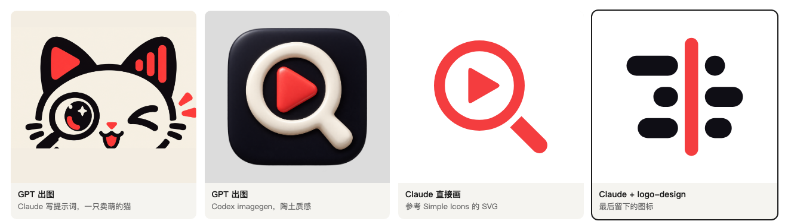
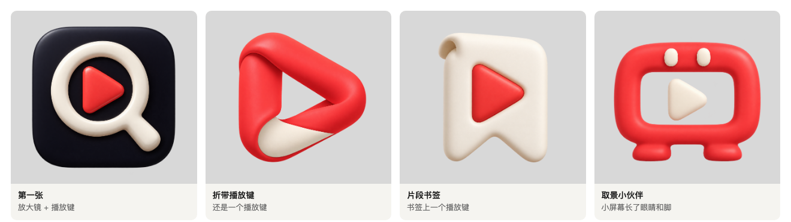
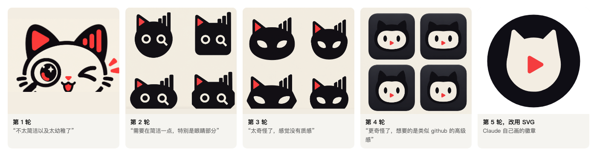
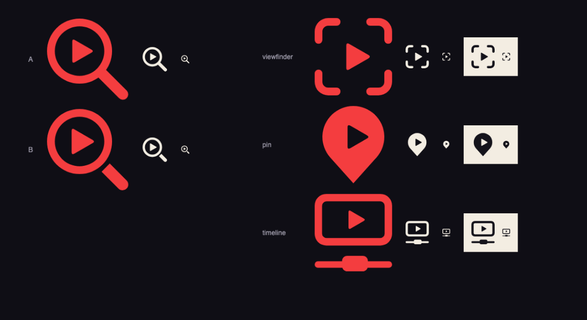
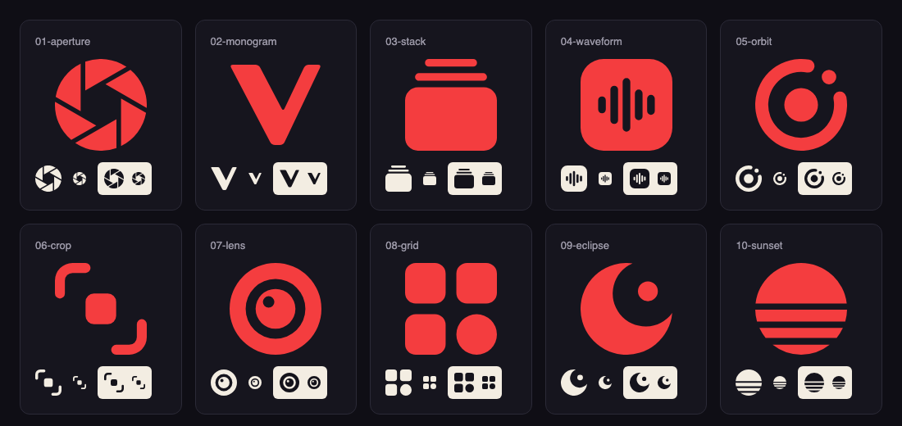
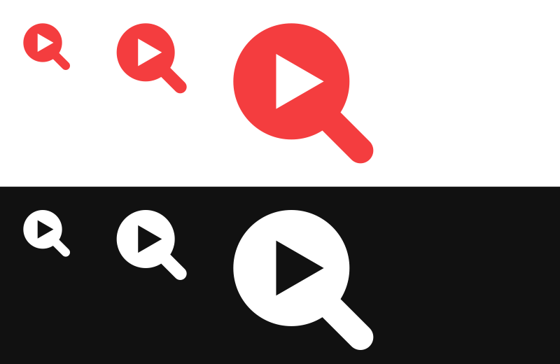
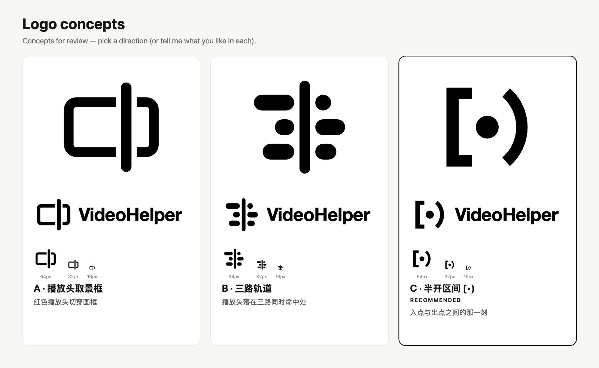
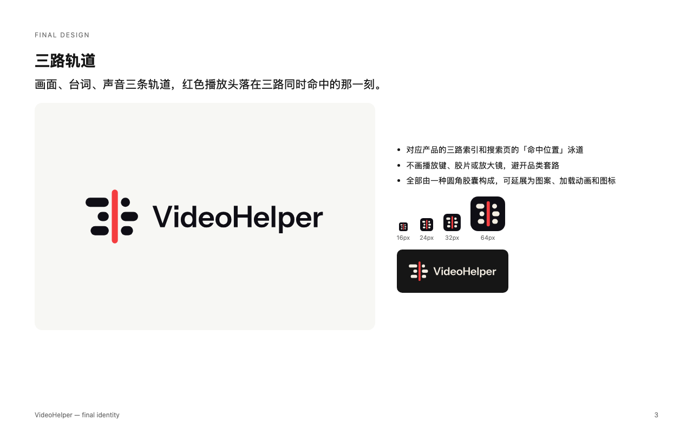
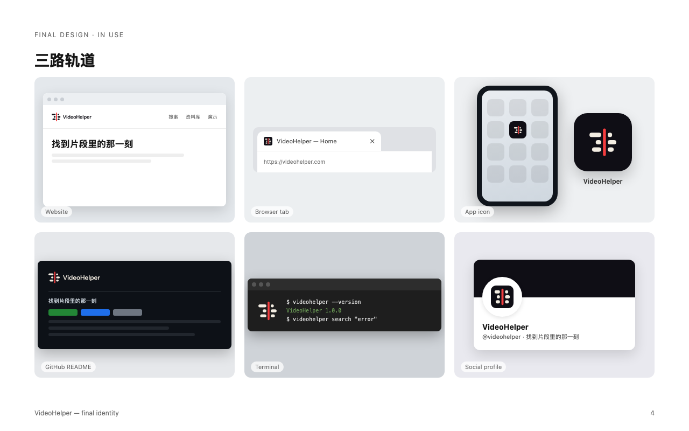
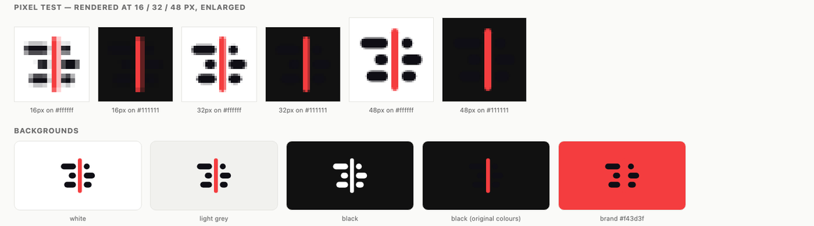

10 月 28 日凌晨，我想给 [VideoHelper](https://videohelper.ozine.me/) 做一个 logo。VideoHelper 是我在做的本地视频检索工具，用一句话就能找到视频里的某个画面、某句台词或某段声音。

接下来的 46 分钟，我先后用了 Codex、ChatGPT 和 Claude。模型画了猫、放大镜、陶土质感的播放键，还有十个抽象图标。我一遍遍地说要简洁、要有质感、要有高级感，最后对 Claude 说的是：

> 都不太行 删掉吧

将近两个小时后，我装了一个叫 [logo-design](https://github.com/kaankiziltug/logo-design-skill) 的 skill，只输入了一句话：

> 为当前项目设计一个 logo

2 分 17 秒后，它交回三个方案。我选了其中一个，又过了 4 分钟，拿到了全套文件。VideoHelper 现在用的就是这个图标。



最后这个图标和第三张的放大镜，背后是同一个 Claude， 同一个模型。这件事让我很想弄明白。

我在自己的月度总结里给过一个解释：我的提示词太空泛，只说要美感、要设计感，没说清楚到底要什么。写这篇文章时，我把那一晚的会话记录全部翻了一遍，发现这个解释只对了一半。**用 skill 时我提的需求，比之前每一次都短，也没有任何具体描述。** 我的提示词根本没有变好。

那差距到底在哪里？

## 先把对照组摆清楚

那一晚我无意中做了一组对照实验。不过我得先纠正自己的一个说法。

我一直说“背后都是同一个大模型”，查完记录，这句话只对后三组成立：

| 组   | 谁来想                           | 谁来画          | 产物  | 我当时说的话                             |
| --- | ----------------------------- | ------------ | --- | ---------------------------------- |
| 1   | GPT（Codex）                    | GPT 生图       | 位图  | “为当前 videohelper 生成一个风格化 app 图标”   |
| 2   | Claude 写提示词                   | GPT 生图       | 位图  | “想要动漫化，扁平化，有记忆点的”                  |
| 3   | Claude Opus 5.5               | Claude 写 SVG | 矢量  | “帮我生成一个 videohelper 的 icon，要简洁有质感” |
| 4   | Claude Opus 5.5 + 我自己做的 skill | Claude 写 SVG | 矢量  | “为 videohelper 画一个 icon”           |
| 5   | Claude Opus 5.5 + logo-design | Claude 写 SVG | 矢量  | “为当前项目设计一个 logo”                   |

前两组换了模型，也换了媒介，不能和最后的结果直接比。后三组才是同一个模型、同一种媒介。

这反而让问题变得好回答。从第 2 组到第 5 组，每往下走一步，大致只变了一样东西。

## 第 1 组：Codex 画得很好，但谁都能用

我先在 Codex 里调用 imagegen。它读了 README 和前端的配色，说要做一个“融合播放键与检索镜头的立体图标”。

我让它重新生成，并用了一段现成的模板，要求给出几个概念不同的方案。它问了我三个问题，我选的是“亲切、有趣、有记忆点”和柔和立体。这个选择是我自己做的，怪不到它头上。



单看渲染，这几张完成度很高。陶土的高光、折带的转折，都像真实的物体。Codex 自己报告透明边缘有杂点，用模型清理了一轮也没有改善，最后老实告诉我清理效果不理想。

但我看着它们，总觉得哪里不对。放大镜里一个播放键，这个图标可以属于任何一个视频工具。

## 第 2 组：提示词很具体，但想法错了

我转去找 Claude，让它帮我写提示词，再拿到 ChatGPT 出图。它给了三个方向，我挑了“声波猫”。提示词是这样的：

```text
A minimalist anime-style cat head mascot: the left ear is a rounded red
play-button triangle, the right ear is a short sound wave of three bold
bars, both eyes are round magnifying glasses with big sparkling anime
pupils inside, a tiny triangular nose and a small "w" mouth.
...
Strict 3-color palette: deep ink black #0f0e15, warm paper cream #f3ede2,
signal red #f43d3f.
```

这段提示词一点也不空泛。耳朵、眼睛、配色都写死了，后面还跟着一串负面提示词。GPT 也老实照做了：左耳是播放键，右耳是声波，眼睛是放大镜。

问题恰恰在这里。它忠实地执行了我的想法，而这个想法本身不成立。

我在 Claude 和 ChatGPT 之间来回跑了五轮：



每一轮，Claude 都能说出上一张哪里不好，也确实说得很对。第 3 轮它说：“一个图标里塞了‘视频、声音、搜索’三个意思，放不下”。提示词里写了 GitHub Octocat，到第 4 轮，GPT 画出了一只山寨的 GitHub 猫，它也马上指出这是自己提示词的问题。

但我的反馈始终只有感受：太幼稚、太奇怪、没有质感、要高级感。Claude 只能猜，猜完往提示词里加词。到了后面几版，提示词里出现了这样的句子：

```text
Geometric precision, consistent corner radii, optical balance,
generous whitespace, Swiss modernist design, the kind of iconic
mark a top branding studio would make. Works at 16px.
```

我在用形容词召唤一个缥缈结果。“一线品牌工作室会做的标志”，写进提示词并不会让图变成那样。

还有一个细节。`Works at 16px` 这句话出现在好几版提示词里，可 Claude 写的 7 版提示词，每一版结尾都在说类似的话：还没有实际出图验证。16px 能不能看清，在这个流程里只是一个愿望，没有人（或 Agentr）去测。

## 第 3 组：几何精确了，还是不行

第 4 轮结束时，Claude 给过一个诊断：

> AI 在“高级感”上能做到的已经差不多了。它在精确几何上一直不稳，比如对称、圆角统一，而这恰恰是高级感的来源。

这个说法很有说服力。生图模型出的是位图，圆不够圆，角不够齐，那换成 SVG 不就解决了？

于是我让 Claude 直接写 SVG，并参考 [Simple Icons](https://simpleicons.org)。它的第一反应还是放大镜和播放键。我说不要放大镜，它换成取景框、定位针、时间轴，播放键都还在。



我说：

> 不一定要突出找到这个特点，也不一定要有播放键，有高级感就行，一次性生成 10 个给我



这十个图标几何上都很干净，每一个都在 16px、32px、深色和浅色背景上渲染过。如果精确几何就足以带来高级感，它们早该过关了。

可我看了一圈，还是说不太行。

Claude 对 09 号月牙的评语点出了原因：“最有高级感、最安静，只是和视频没什么联系”。这一组卡在两头。和视频有关的，都是放大镜和播放键；和视频无关的，只是一个好看的图形，贴到别的产品上也一样成立。

所以 Claude 的那个诊断最多只对了一半。精确几何也许是高级感的必要条件，但它自己接下来画的图说明，只有这一条远远不够。

## 第 4 组：我自己做的 skill，又画了一个放大镜

和第 3 组同时，我开了另一个会话，让 Claude 提炼 Simple Icons 的特点，做成一个 skill。

它做得很认真。它下载了全部 3,467 个图标，统计结构和配色：100% 只有一个 path，94% 长边贴满 24 个单位，路径长度中位数 746 个字符，颜色饱和度中位数 0.84。它还写了检查脚本，拿真实图标做测试，3,465 个都能通过。

然后我运行：

> /simple-icon-style 为 videohelper 画一个 icon



一个实心放大镜，中间挖出一个播放键。

公平地说，这个会话不知道我在另一边说过不要放大镜。但这正好说明问题：格式完全合规，想法还是那个想法。不到三分钟，我就让 Claude 把这个 skill 删了。

这个 skill 记录的是优秀图标的文件长什么样。它能告诉模型“只用一条 path”，却没有任何一步会说“这个想法太普通，换一个”。**所以“有没有 skill”不是分界线，关键看 skill 里装了什么。**

## 第 5 组：它先做了一堆画图以外的事

将近两个小时后，我装上 logo-design，输入那句话。这次模型的行为完全不同。

它没有马上画。它先读了 README、配色变量和前端现有的标记组件，又去 logo 库里搜了同类题材。然后给出三个方向，全部是黑白的，还列出了自己的假设：

> 避开这个品类的常见套路，比如播放三角、胶片、放大镜、场记板

我看到这句话时有点想笑。这一晚我收到的几乎全是这些东西。而且这个会话是刚清空的，当时的记忆里也没有任何关于放大镜的记录，它是自己把这些排除掉的。



- **A，播放头取景框**：在网站现有的标记上精修，让一条播放头切穿画框。它自己说风险是太通用，容易被看成分屏对比。
- **B，三路轨道**：画面、台词、声音三条轨道，播放头停在三路都命中的位置。这对应产品的三路索引，以及搜索页上的“命中位置”泳道。
- **C，半开区间 `[•)`**：剪辑里用括号标入点和出点，中间的点是你要找的那一刻，同时也是接口约定里的 `[start, end)`。这是它推荐的方案。

A 是从旧标记改过来的，我不太意外。B 和 C 我完全没想到，而且它们和 VideoHelper 绑得很紧，换到别的产品上就说不通了。这是这一晚第一次出现这种情况。

我没有选它推荐的 C，回了一句“用 b 做完整套件”。4 分钟后，我拿到了配色、横排竖排组合、小尺寸版、favicon、App 图标、展示板和使用规范。





## 差距到底在哪一层

把几组放在一起看：

| 变化              | 结果                  | 说明什么     |
| --------------- | ------------------- | -------- |
| 位图换成 SVG（2 → 3） | 几何干净了，我还是不满意        | 工艺不是主要差距 |
| 加上格式规范（3 → 4）   | 更规整了，还是放大镜          | 规范不是主要差距 |
| 加上设计流程（4 → 5）   | 第一次出现没见过、又属于这个产品的想法 | 差距主要在这里  |

更有意思的是，这个 skill 带了 14 份参考文档，共两千多行，但那次运行里一份都没打开。起作用的只有这`SKILL.md` 这个 17KB 的流程说明，加上几个脚本和一个 1,432 个 logo 的参考库。它没有灌给模型更多设计知识，主要是改变了模型做事的顺序。

具体来说，它做了五件事。

### 第一，它重新定义了任务

`SKILL.md` 第一段就写：

> A logo is an **identifier, not an explanation**.

logo 是用来认出来的，不用解释产品。

回头看，我所有的提示词都在做解释：这是视频，能听声音，能搜索。那只猫就是一份功能清单，把三个符号并排摆在脸上。
### 第二，它把第一反应列为禁区

流程里有一步，要求先列出这个品类的陈词滥调，默认不许用。写概念时还有一条标准：一句话如果也能用来描述竞品的 logo，它就不算概念。

这一条打在了我最大的问题上。前四组里，除了我明说“不一定要有播放键”才画出来的那十个，每一个图形都带着播放三角。不管是 GPT 还是 Claude，不管有没有我自己做的 skill，放大镜和播放键都是模型最先想到的答案。

**模型的第一反应，大概也是所有人的第一反应**。它是从大量现有内容里学来的，答案自然平均。如果没有东西拦一下，它就会把这个答案交给你，并且交得又快又干净。

### 第三，它去产品内部找形状

第一反应被禁掉之后，模型只能往别处找。

Claude 帮我写提示词时，只读了一份 CSS，用来取配色。第 5 组读到的是产品本身，方案也来自这里：搜索页的泳道，接口里的时间区间。这些是 VideoHelper 独有的东西，靠“简洁、有质感”这些词是摸不到的。

不过读得多并不够。第 1 组的 Codex 也读了 README，还是画了放大镜。我认为，第二步和第三步要连起来才有用：先把容易的答案堵死，读到的材料才会被真正用上。
### 第四，它把“高级感”换成了能检查的东西

我到现在也说不清质感是什么。但下面这些，更容易检查：

- 三条轨道高 36，间距 20，全部是圆角胶囊；播放头宽 24，两侧各留 12 的切口。
- 深色版每个形状内缩 1 个单位，抵消深底上的视觉膨胀。
- 24px 以下换成单独的小尺寸版，轨道和间距都加粗。
- 红色只用在播放头上，和米纸色的对比度是 3.23，高于图形元素要求的 3:1。

它还写过一条提醒：“在 SVG 代码里画图，等于闭着眼画图。”所以它要求每次改完都渲染出来，自己看。这一场里，模型看完 B 的初稿，说小短段“太碎，像混音推子”，改成了现在的三条轨道。

测试页也确实查出了问题：



下面一排右边第二张，黑底上直接用原色，轨道完全消失，只剩一条红线，所以才需要深色版。导出的 favicon 一开始是透明底加米纸色，放在浅色标签栏上看不见，也被换成了墨黑圆角底。

这些问题都很具体，具体到不需要审美就能发现。

不过这一步解释不了想法为什么变好。第 3 组也渲染过各种尺寸，第 4 组也有检查脚本，它们都没有因此得到一个好想法。精确的几何和测试保证的是好想法在落地时不走样，却没办法把一个普通的想法变好。

### 第五，它让我只做一个容易的判断

一次给我十个彩色图标，我能说的只有“不太行”。

这次它给我三个黑白方案。每个方案有一句话概念，有它自己说出来的风险，有一个推荐，然后停下来等我。颜色放到最后，它的理由是颜色会引发口味之争。

我要回答的问题变了：从“好不好看”变成了“哪个想法更对”。前一个问题我答不好，后一个我能答。
## 所以，为什么我的提示词出不来好看的 logo

回到最初的问题，我现在的答案是这样的：

1. **我描述的是功能。** 一张图里塞了三个符号，再具体也只是一份清单。
2. **我用风格词要结果。** “高级感”“瑞士设计”“顶级工作室”都是在描述终点。模型不知道怎么走到那里，我也不知道。
3. **我把参考对象当成了模板。** 说像 GitHub，它就画一只 Octocat。我想要的是 GitHub 那种克制，却只能说出它的名字。
4. **我的反馈只有感受。** “太奇怪了”没办法指导下一版，只能换一版试试。
5. **媒介也有一点影响。** 位图难以保证精确几何，透明边缘也不好处理。但第 3 组已经说明，这只是次要原因。

这五条里，前四条靠我自己写提示词解决不了，它们要求写提示词的人已经懂设计。这是个死循环：我不懂设计，所以找 AI；AI 需要懂设计的人来指挥。logo-design 解开它的办法，就是让懂的人先把这份提示词写好。

## 模型其实都知道

我一直在想另一件事：这些道理，模型知道吗？

看记录，它知道。“放不下三个意思”是它自己说的。Octocat 的问题是它自己发现的。GitHub 的高级感来自单色、圆形外轮廓和负空间，也是它分析出来的。

可在第 1 到第 4 组里，这些知识只在我追问之后才出现，而且只用来解释上一张图为什么不好。到了下一张图，它又回到满足字面要求。我说要猫，它就把猫画到最好。我说要十个，它三分钟后就给我十个。

这大概是这件事里我最大的收获。**同一个模型，能力没有变，变的是它默认走哪条路。** 没有约束时，它倾向于最快地满足你说出口的那句话。这在写代码时往往是优点，需求明确，做完验证就行。做 logo 时，用户说出口的话恰恰靠不住，这个优点就变成了缺点。

logo-design 的第一句话是让模型扮演资深设计师，但真正起作用的是后面那些关卡：先写简报，先看同类，先列禁区，先出黑白，先测试，到了检查点必须停下。每一步都在阻止模型过早交卷。

这些东西不是知识，是工作顺序。一个有经验的设计师不一定比模型知道得多，他只是不会一上来就画。

## 我学到的东西

我在月度总结里写，设计不好的问题在于我把决策权交给了 AI。现在看，这句话也要改。用 logo-design 时，我交出去的决策权比之前多得多：一句要求都没提，连颜色都是它从项目里自己找的。

区别在于，这次替我做决定的是一套写下来的标准。

以后再做自己不懂的事，我会先改两个习惯：

**先找流程，再写提示词。** 我花了 46 分钟来回试，方向本身就错了。自己不懂的领域，先看有没有人把做事的顺序写下来。

**看一个 skill，先看它会不会说“不”。** 我自己那个 skill 只会说“文件格式对了”。logo-design 会说“这个想法太常见，不许用”。能否决第一反应的流程，才能把模型带到它自己走不到的地方。

我到现在还是说不清什么是设计感。这件事没有变。变的是，有人把它拆成了一步一步的做法，模型照着做，就走到了我自己描述不出来的地方。
