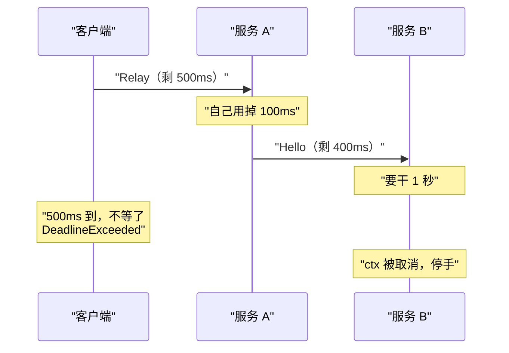

订单服务要问用户服务一句话：“42 号用户存在吗？”两个服务在不同的机器上，这句话得走网络。用 HTTP 加 JSON 手写的话，调用方要拼 URL、把参数转成 JSON、发请求、判断状态码、把响应体解回结构体，还要自己想清楚超时多久、对方返回的错误长什么样。被调用方把同样的事反着做一遍。两边对 URL、字段名、错误格式的约定只写在文档里，有一边改了，另一边要到运行时才发现。

RPC（Remote Procedure Call，远程过程调用）想把这些都藏起来，让调用方只写一行 `client.GetUser(ctx, req)`。gRPC 是 Google 开源的一套 RPC 框架。这篇文章先讲 RPC 这个想法本身，再讲 gRPC 的每个部件怎么工作：Protocol Buffers、四种调用模式、元数据、拦截器、deadline、错误码，最后是把 gRPC 接口转成 HTTP/JSON 的 grpc-gateway。

## RPC 这个想法，以及它一开始漏掉的东西

Birrell 和 Nelson 1984 年发表的《Implementing Remote Procedure Calls》完整描述了一套 RPC 的实现，gRPC 今天的结构和它是同一个样子。论文说一次远程调用涉及五段程序：调用方、调用方的 stub、两边各一份的 RPC 运行库、服务方的 stub、服务方。stub 可以译成“桩”，是一段夹在中间的代码：调用方以为自己在调一个普通的本地函数，实际调到的是 stub，stub 负责把“调哪个函数、参数是什么”打包成网络包，交给运行库发出去；对面的 stub 拆包，再用一次普通的本地调用去调真正的实现。结果沿原路返回。

论文里还有一点延续到了今天：stub 不用手写。作者有一个叫 Lupine 的程序，根据接口定义自动生成两边的 stub。gRPC 里对应的东西是 `protoc` 和它的插件。


这篇论文有一个设计原则：远程调用的语义要尽量贴近本地调用。作者据此做了一个现在看来很扎眼的决定：只要没有机器或通信故障，就不限制一次远程调用的时长。理由有两条：本地函数调用没有超时，而且他们的语言本身就有中止一个任务的机制，专门为 RPC 再设计一套超时会让程序员的世界变复杂。

要注意，论文并没有忽略网络。调用方等待时会定期给对方发探测包，对方宕机或者通信中断，调用方会收到异常；丢包靠重传，重复的调用包靠调用 ID 识别。它给的保证是：调用正常返回，说明服务端的过程恰好执行了一次；收到异常，说明执行了一次或者一次都没有，调用方不知道是哪种。它唯一不管的情况是对方还活着、只是迟迟不回，比如死锁或死循环，这时调用方会一直等下去，和本地调用一样。

gRPC 在“慢”这件事上走了相反的方向：慢也算一种要处理的失败，调用方用 deadline 说清楚自己最多等多久，取消还会沿着调用链往下传。gRPC 官方 2015 年 9 月的一篇博客《gRPC Motivation and Design Principles》列出的设计原则里，取消与超时、流量控制、元数据交换、标准化的状态码都单独成条，还明确说要避开“忽略网络”的错误认识。所以读后面几节时可以带着这条线索：**gRPC 把调用写得像本地函数，同时把“这是一次网络调用”带来的那些事（等多久、谁取消、出了什么错）放到了接口里，要求你处理。**

## gRPC 由哪几块拼成

按上面那篇博客的说法，Google 内部用一套叫 Stubby 的 RPC 设施连接数据中心里的大量服务，到当时已经用了十多年；Stubby 不基于任何标准，和内部设施绑得太紧，不适合公开。HTTP/2 这些标准出现之后，他们决定重做一套，这就是 gRPC。

拆开看，gRPC 是三样东西的组合：

1. **接口定义语言**。在 `.proto` 文件里写清楚有哪些服务、每个方法收什么发什么。默认用 Protocol Buffers，官方文档说也可以换成别的格式。
2. **代码生成**。`protoc` 读 `.proto`，生成消息的结构体、客户端 stub 和服务端要实现的接口。
3. **传输协议**。请求和响应走 HTTP/2，具体怎么摆放由《gRPC over HTTP2》这份协议文档规定。

本文的实验用的是下面这份定义，五个方法里前四个各对应一种调用模式：

```proto
service Demo {
  // 一元：一个请求，一个响应
  rpc Hello(HelloRequest) returns (HelloReply) {
    option (google.api.http) = {get: "/v1/hello/{name}"};
  }
  // 服务端流：一个请求，多个响应
  rpc Countdown(CountdownRequest) returns (stream Tick);
  // 客户端流：多个请求，一个响应
  rpc Sum(stream Number) returns (SumReply);
  // 双向流：两边各发各的
  rpc Chat(stream ChatMsg) returns (stream ChatMsg);
  // 用来演示 deadline 传播：服务端再去调下游的 Hello
  rpc Relay(HelloRequest) returns (HelloReply);
}

message HelloRequest {
  string name = 1;
}

message SumReply {
  int64 total = 1;
  int32 count = 2;
}
```

（其余几个消息都只有一个字段，这里省略。`option (google.api.http)` 那一行是给 grpc-gateway 用的，最后一节再讲。）

生成 Go 代码需要 `protoc` 加两个插件：`protoc-gen-go` 生成消息结构体，`protoc-gen-go-grpc` 生成客户端和服务端接口。

```bash
protoc -I proto \
  --go_out=gen --go_opt=paths=source_relative \
  --go-grpc_out=gen --go-grpc_opt=paths=source_relative \
  proto/demo.proto
```

## Protocol Buffers：字段靠编号认，不靠名字

Protocol Buffers（下面简称 protobuf）负责把结构体变成字节。它的官方文档这样介绍自己：像 JSON，但更小更快，并且能生成各语言的原生代码。Google 在 2008 年把它开源。

它和 JSON 最大的区别在 `string name = 1;` 里那个 `= 1`。这是**字段编号**。JSON 把字段名原样写进数据里，protobuf 的二进制数据里只有编号，没有名字，也没有声明的类型。官方编码文档说得很直接：字段的名字和类型只能在解码那一端对照 `.proto` 文件才能知道。

把几个消息编码后打印出十六进制，能直接看到这一点：

```
HelloRequest{Name:"world"}   7 字节  0a 05 77 6f 72 6c 64
Number{Value:150}            3 字节  08 96 01
Number{Value:-1}             11 字节  08 ff ff ff ff ff ff ff ff ff 01
SumReply{Total:6, Count:3}   4 字节  08 06 10 03
SumReply{}（全是零值）             0 字节  
```

第一行的 `0a` 是标签（tag）。按编码文档的公式，标签等于 `(字段编号 << 3) | 线路类型`。`0a` 是二进制 `00001 010`，前五位是字段编号 1，后三位是线路类型 2，表示“后面跟一个长度，再跟这么多字节”。接下来的 `05` 是长度，再后面五个字节就是 `world`。

第二行的 `08` 是字段 1、线路类型 0，表示后面是一个 varint（变长整数）。varint 每个字节用低 7 位存数据，最高位表示“后面还有没有”。`96 01` 去掉最高位、低位在前拼起来就是 150。数值越小占的字节越少，这是 protobuf 数据紧凑的主要来源。

这套编码带来三个要记住的后果。

**编号一旦用了就不能改，也不能复用。** 数据里只有编号，把字段 2 从 `count` 改成别的含义，旧数据就会被按新含义解读。官方文档的要求是：消息投入使用后编号不能改；删掉字段时要用 `reserved` 把它的编号占住，防止以后有人再拿来用。反过来，改字段名对二进制数据没有任何影响。编号 1 到 15 的标签只占一个字节，16 到 2047 占两个，文档建议把这段小编号留给最常设置的字段。

**新旧版本可以共存。** 加字段只要用新编号，旧程序解码时遇到不认识的编号不会报错，而是把这段数据原样保留。实验里用有两个字段的 `SumReply` 编码，再用只认识字段 1 的 `Number` 去解码：

```
旧结构解码新数据：value=6，不认识的字段原样留着：10 03
```

服务可以一个一个升级，不需要所有调用方同时换版本，靠的就是这条规则。

**零值不上线，所以分不清“没填”和“填了零”。** 上面最后一行，全是零值的 `SumReply` 编码出来是 0 个字节。proto3 的文档明确提醒：这类字段解析之后没有办法判断它是被显式设成了默认值，还是根本没设。文档举的例子是，不要设计一个“设为 `false` 时开启某行为”的布尔字段。确实需要区分时，给字段加 `optional` 修饰。

另外一个小坑在第三行：`int64` 类型的 `-1` 占了 11 个字节（1 字节标签加 10 字节数值）。文档的解释是 `intN` 类型用补码表示负数，当成无符号数看最高位是 1，所以十个字节全得用上。经常出现负数的字段应该用 `sint32` / `sint64`，它们先做一次 ZigZag 变换再编码。

## 一次调用在网络上长什么样

为了看清 gRPC 到底往网络上发了什么，实验里用 Go 标准库的 `net/http` 起了一个明文 HTTP/2 服务冒充 gRPC 服务端，把 grpc-go 客户端发来的请求打印出来：

```
POST /demo.v1.Demo/Hello HTTP/2.0
  content-type: application/grpc
  te:           trailers
  grpc-timeout: 1997945u
  user-agent:   grpc-go/1.84.0
  x-request-id: req-42
  body (12 字节): 00 00 00 00 07 0a 05 77 6f 72 6c 64
```

对照协议文档，每一行都有着落：

- 方法固定是 `POST`，路径是 `/包名.服务名/方法名`。调哪个方法由路径决定。
- `content-type` 是 `application/grpc`。
- `grpc-timeout` 是 deadline。客户端设的是 2 秒，发出去的是 `1997945u`，也就是 1997945 微秒，发请求前花掉的那两毫秒已经扣掉了。
- `x-request-id` 是业务自己加的元数据，就是一个普通的 HTTP/2 头。
- 请求体不是裸的 protobuf，前面多了 5 个字节：1 字节压缩标志（`00` 表示没压缩），4 字节大端长度（`00 00 00 07`）。后面 7 个字节正是上一节的 `0a 05 77 6f 72 6c 64`。协议文档管这叫“带长度前缀的消息”。有了长度，一条流里才能连着放多条消息，流式调用靠的就是它。

响应可以反过来用 `curl` 看。手工拼一个带前缀的请求体，直接发给真正的 gRPC 服务端：

```bash
printf '\x00\x00\x00\x00\x07\x0a\x05world' | curl -sv --http2-prior-knowledge \
  -H 'content-type: application/grpc' -H 'te: trailers' \
  --data-binary @- http://127.0.0.1:50551/demo.v1.Demo/Hello -o out.bin
```

```
< HTTP/2 200 
< content-type: application/grpc
< 
< grpc-status: 0
< grpc-message: 
```

空行之前是响应头，之后那两行是 trailer，也就是在响应体发完之后才发的一组头。gRPC 的调用结果放在 trailer 的 `grpc-status` 里，0 表示成功。把名字换成一个会让服务端返回“找不到”的值，结果是这样：

```
< HTTP/2 200 
< content-type: application/grpc
< grpc-status: 5
< grpc-message: %E6%B2%A1%E6%9C%89%E8%BF%99%E4%B8%AA%E4%BA%BA
```

**HTTP 状态码仍然是 200，错误写在 `grpc-status: 5` 里。** 协议文档规定响应的 HTTP 状态就是 200，gRPC 自己的状态必须放在 trailer 里，成功时也要发。这样安排的理由文档没有写。一个说得通的解释是：流式响应发到一半也可能失败，而 HTTP 状态码在第一个字节发出时就定死了，结果只能放在最后。这是推断，不是官方说法。

对排查问题来说，这意味着只看 HTTP 状态码的日志和监控，会把上面这种业务错误也记成 200。

每一次 RPC 对应一条 HTTP/2 流（stream），协议文档直接拿 HTTP/2 的流编号当调用的标识。HTTP/2 允许一条 TCP 连接上同时跑很多条流，所以很多次调用可以共用一条连接，官方博客把这一点列为 gRPC 相对传统 HTTP/JSON 的优势之一。HTTP/2 能做到这一点，是因为它把每个请求和响应拆成带流编号的二进制帧，不同流的帧在同一条 TCP 连接上交错传输，接收方再按编号各自拼回去。

## 四种调用模式

`.proto` 里参数或返回值前面加不加 `stream`，一共四种组合。生成的 Go 客户端接口是这样的：

```go
type DemoClient interface {
	Hello(ctx context.Context, in *HelloRequest, opts ...grpc.CallOption) (*HelloReply, error)
	Countdown(ctx context.Context, in *CountdownRequest, opts ...grpc.CallOption) (grpc.ServerStreamingClient[Tick], error)
	Sum(ctx context.Context, opts ...grpc.CallOption) (grpc.ClientStreamingClient[Number, SumReply], error)
	Chat(ctx context.Context, opts ...grpc.CallOption) (grpc.BidiStreamingClient[ChatMsg, ChatMsg], error)
	Relay(ctx context.Context, in *HelloRequest, opts ...grpc.CallOption) (*HelloReply, error)
}
```

**一元（unary）** 是一个请求换一个响应，和普通函数调用一样。`Hello` 直接返回结果。

**服务端流** 是发一个请求，拿回一条流，从里面不断读消息，直到服务端说发完了。`Countdown` 返回的流对象有 `Recv()` 方法，读到 `io.EOF` 表示正常结束。服务端那边，方法 `return nil` 就是结束这条流。适合结果很多或者要持续推送的场景，比如导出大量记录、订阅变更。

**客户端流** 反过来，客户端连着发很多条，服务端最后回一条。`Sum` 的客户端用 `Send()` 发，发完调 `CloseAndRecv()`，意思是“我发完了，把结果给我”。服务端的 `Recv()` 读到 `io.EOF` 就知道对方发完了。适合上传大文件、批量上报。

**双向流** 是两边各有一条独立的流，可以按任意顺序读写。官方文档举的两种用法是：服务端等客户端全部发完再回，或者像打乒乓球一样一来一回。

四种模式连着跑一遍，客户端这边的输出：

```
一元：
  收到 你好，world
服务端流：
  收到 3
  收到 2
  收到 1
  流结束（io.EOF）
客户端流：
  发了 3 个数，总和 6
双向流：
   收到：a
   收到：b
  CloseSend 之后再 Recv： EOF
```

关于流有几条边界。

官方文档保证的是**单次 RPC 内部**消息有序。两次不同的调用之间没有顺序保证。

一条流就是一次 RPC，所以 deadline 管的是整条流，不是其中某一条消息。实验里给一条双向流设了 300ms 的 deadline，每 120ms 往返一次，前三次成功，第四次 `Recv` 得到 `DeadlineExceeded`。打算长期开着的流不能直接套用给一元调用准备的超时。

选哪种模式，官方文档没有给规则。从机制上看，能用一元就用一元：它的超时、重试、负载均衡都以“一次调用”为单位，最容易推理。流在消息很多、需要边产生边发送、或者要服务端主动推送时才值得用。这是推断出来的建议。

## 元数据：跟着调用走，但不属于参数的信息

有些信息每次调用都要带，却不是任何一个方法的业务参数：身份凭证、请求 ID、链路追踪的上下文。把它们塞进每个请求消息里显然不合适。gRPC 的办法是元数据（metadata）：一组键值对，随调用一起发送，底层就是 HTTP/2 的头，上一节抓到的 `x-request-id: req-42` 就是一条。

元数据分三段传：

- 客户端发给服务端的，在请求消息之前发；
- 服务端发给客户端的 header，在第一条响应消息之前发；
- 服务端发给客户端的 trailer，在调用结束时和状态码一起发。只有服务端能发 trailer。

Go 里元数据挂在 `context` 上。客户端这样发、这样收：

```go
ctx := metadata.AppendToOutgoingContext(context.Background(),
	"X-Request-ID", "req-42", // 键会被转成小写
	"x-tag", "a", "x-tag", "b", // 同一个键可以有多个值
	"trace-bin", string([]byte{0x00, 0xff, 0x10}), // -bin 结尾的键可以放任意字节
)
var header, trailer metadata.MD
_, err = c.Hello(ctx, &demov1.HelloRequest{Name: "world"}, grpc.Header(&header), grpc.Trailer(&trailer))
```

服务端用 `metadata.FromIncomingContext(ctx)` 读，用 `grpc.SetHeader` 和 `grpc.SetTrailer` 写。运行结果：

```
  [S] 收到 x-request-id  = ["req-42"]
  [S] 收到 x-tag         = ["a" "b"]
  [S] 收到 trace-bin     = ["\x00\xff\x10"]
  [S] 收到 :authority    = ["127.0.0.1:59038"]
  [S] 收到 content-type  = ["application/grpc"]
  [S] 收到 user-agent    = ["grpc-go/1.84.0"]
  [S] 这个 ctx 上的“待发出”元数据：map[]
客户端收到 header  x-served-by = ["S"]，content-type = ["application/grpc"]
客户端收到 trailer x-cost-ms   = ["3"]
```

从输出里能读出几条规则，都能在官方文档里找到对应：

- 键不区分大小写，grpc-go 会统一转成小写。发的是 `X-Request-ID`，收到的是 `x-request-id`。
- 值是字符串列表，同一个键可以有多个值。
- 值默认只能是可打印的 ASCII 字符。要放任意字节，键名必须以 `-bin` 结尾，库会自动做 base64 编解码，应用拿到的还是原始字节。
- `grpc-` 开头的键留给 gRPC 自己用，应用不能用。
- gRPC 自己用的头（`content-type`、`user-agent` 等）也混在同一个 map 里。

最容易踩的坑在倒数第三行。**服务端收到的元数据不会自动转给下游。** 在 Go 里，“收到的”和“待发出的”是 `context` 上两份独立的数据，服务端的 `ctx` 上待发出的那份是空的。另做了一个实验：客户端带着 `x-request-id` 调 A，A 把同一个 `ctx` 原样传给调 B 的客户端，B 打印出来的 `x-request-id` 是空的。要透传必须自己读出来再写进去，这件事适合放在拦截器里做。

另一个限制是大小。协议文档建议服务端把请求头的总大小限制在 8 KiB，元数据不适合放大块数据。

## 拦截器：gRPC 的中间件

日志、鉴权、指标、透传元数据，这些事每个方法都要做，逻辑又和具体方法无关。gRPC 提供的挂载点叫拦截器（interceptor），官方文档直说它就是别处叫“过滤器”或“中间件”的东西。写过 Go `net/http` 中间件的话，这是同一个模式：用一个函数把真正的处理逻辑包一层，在调用它之前和之后各做点事。

grpc-go 里服务端一元拦截器是一个函数，拿到请求和一个 `handler`，自己决定在调用 `handler` 前后做什么：

```go
tag := func(name string) grpc.UnaryServerInterceptor {
	return func(ctx context.Context, req any, info *grpc.UnaryServerInfo, handler grpc.UnaryHandler) (any, error) {
		fmt.Printf("  服务端 %s 进入  %s\n", name, info.FullMethod)
		resp, err := handler(ctx, req) // 调下一个拦截器，最后一个调到业务方法
		fmt.Printf("  服务端 %s 返回  code=%v\n", name, status.Code(err))
		return resp, err
	}
}
```

服务端用 `grpc.ChainUnaryInterceptor(tag("A"), tag("B"))` 装上两个，客户端用 `grpc.WithChainUnaryInterceptor` 装一个同样只打印日志的拦截器。其中一次调用的输出：

```
调用 Hello(nobody)：
  客户端拦截器 发出  /demo.v1.Demo/Hello
  服务端 A 进入  /demo.v1.Demo/Hello
  服务端 B 进入  /demo.v1.Demo/Hello
  [S] Hello("nobody") 没有 deadline
  服务端 B 返回  code=NotFound
  服务端 A 返回  code=NotFound
  客户端拦截器 收到  code=NotFound
```

写在前面的在外层：A 先进后出，把 B 和业务方法整个包在里面。grpc-go 源码里 `ChainUnaryInterceptor` 的注释也是这么说的，第一个拦截器在最外层。顺序会影响行为。官方文档举的例子是缓存和日志两个客户端拦截器：日志放在靠网络的一侧，记下的是真正发出去的请求；放在靠应用的一侧，命中缓存的调用也会被记下来。

拦截器有三条边界。

一元调用和流式调用的拦截器是两套类型。实验里只装了一元拦截器，然后调服务端流方法 `Countdown`，没有任何拦截器输出。鉴权这类逻辑如果只写了一元版本，流式方法就是裸奔的，要用 `ChainStreamInterceptor` 另装一份。

客户端和服务端的拦截器也是两套接口，不能混用。

拦截器是按调用生效的。官方文档特别说明，它管不了 TCP 连接、端口、TLS 配置这类连接层面的事。

## deadline 传播：把“我还愿意等多久”告诉下游

deadline 是一个时间点，表示调用方最晚愿意等到什么时候。官方文档有两句话值得先记下：gRPC 默认**不设** deadline，客户端可能一直等下去，所以应该总是显式设置；超过 deadline 之后，客户端放弃并得到 `DEADLINE_EXCEEDED`。

单次调用的超时不新鲜，gRPC 特别的地方在“传播”。假设客户端调 A，A 又调 B。客户端只愿意等 500ms，A 自己花了 100ms，那 B 最多只有 400ms 可用。B 再慢，客户端也已经走了，继续算下去是浪费。deadline 传播就是让 A 把剩余时间告诉 B。

Go 里设置 deadline 用的就是标准库的 `context`。它给一次请求牵涉到的所有函数和 goroutine 一个共同的“可以停了”的信号，也可以约定最晚什么时候必须停；父 context 被取消，从它派生出来的子 context 会跟着取消。A 的方法收到的 `ctx` 已经带着客户端的 deadline，调 B 时把这个 `ctx` 传下去，传播就发生了：

```go
func (s *server) Relay(ctx context.Context, req *demov1.HelloRequest) (*demov1.HelloReply, error) {
	if dl, ok := ctx.Deadline(); ok {
		fmt.Printf("  [%s] Relay(%q) 剩余时间 %v\n", s.name, req.Name, time.Until(dl).Round(10*time.Millisecond))
	}
	time.Sleep(100 * time.Millisecond) // 假装自己先干了 100ms 的活
	if name, ok := strings.CutPrefix(req.Name, "detach:"); ok {
		// 错误示范：没把收到的 ctx 传下去
		return s.downstream.Hello(context.Background(), &demov1.HelloRequest{Name: name})
	}
	return s.downstream.Hello(ctx, req)
}
```

在网络上传的并不是那个时间点。前面抓包看到的是 `grpc-timeout: 1997945u`，一个剩余时长。官方文档解释了原因：两台机器的时钟可能不一致，直接传时间点会出错，所以 gRPC 把 deadline 换算成扣掉已用时间的超时再发出去。

下面是四种情况的实际输出。B 的 `Hello` 在名字是 `slow` 时要干 1 秒。A 只在有 deadline 时才打印那一行，所以第 4 种情况里没有 A 的输出。

```
1. 客户端给 500ms，A 把 ctx 传给 B，B 很快：
  [A] Relay("world") 剩余时间 500ms
  [B] Hello("world") 剩余时间 400ms
  客户端 110ms 后返回，code=OK
2. 客户端给 500ms，A 把 ctx 传给 B，B 要干 1 秒：
  [A] Relay("slow") 剩余时间 500ms
  [B] Hello("slow") 剩余时间 400ms
  客户端 500ms 后返回，code=DeadlineExceeded
  [B] 中途收到取消：context canceled
3. 客户端给 500ms，A 用 context.Background() 调 B，B 要干 1 秒：
  [A] Relay("detach:slow") 剩余时间 500ms
  [B] Hello("slow") 没有 deadline
  客户端 500ms 后返回，code=DeadlineExceeded
  [B] 干完了
4. 客户端不设 deadline：
  [B] Hello("world") 没有 deadline
  客户端 100ms 后返回，code=OK
```

第 1、2 种情况里，B 看到的剩余时间是 400ms，A 用掉的 100ms 已经扣除。第 2 种情况下，时间一到，B 收到取消信号，停了手。



第 3 种情况是最常见的写错方式。A 调 B 时用了 `context.Background()`，B 那边显示“没有 deadline”。客户端 500ms 后已经拿到超时错误走了，B 还是把 1 秒的活干完了，结果没有人要。请求量大的时候，下游就是这样被已经没人等的请求拖垮的。

还有几件事需要知道。

**服务端要自己检查 `ctx`。** deadline 到了，gRPC 只是把 `ctx` 取消掉，不会把正在运行的方法强行停下来。官方文档写明，服务端应用要负责停掉自己为这次 RPC 发起的活动。实验里的 `Hello` 是用 `select` 等 `ctx.Done()` 才停得下来的。写成一个不看 `ctx` 的 `time.Sleep(time.Second)`，它照样睡满 1 秒。

**两边各自判断成败，结论可能不同。** 官方文档举的例子是，服务端认为“我全发完了”，客户端认为“到我手上时已经过了 deadline”。状态码文档对 `DEADLINE_EXCEEDED` 的说明里也有一句：对会修改系统状态的操作，即使操作已经成功完成，也可能返回这个错误。所以客户端收到超时，**不能推断服务端没执行**。要不要重试、重试会不会重复执行，要靠幂等设计来解决：让同一个操作执行一次和执行多次的效果相同。常见做法有数据库唯一约束、去重表、状态机，以及让客户端给每次操作带一个幂等键。

**Go 里判断超时要看状态码。** 客户端超时拿到的错误，`status.Code(err)` 是 `DeadlineExceeded`，但实测 `errors.Is(err, context.DeadlineExceeded)` 是 `false`。习惯用 `errors.Is` 判断 `context` 错误的代码，在 gRPC 调用上会漏判。

**服务端看到的 `ctx.Err()` 不一定是 `DeadlineExceeded`。** 第 2 种情况里 B 打印的是 `context canceled`。单独用 `curl` 带 `grpc-timeout: 100m` 直接请求服务端 30 次，服务端方法里看到的 30 次都是 `context canceled`。这是官方写明的行为：Deadlines 指南说，客户端设的 deadline 一过，gRPC 服务端会自动取消这次调用，状态是 `CANCELLED`。对应到 grpc-go 1.84.0 的源码，服务端除了用 `context.WithTimeout` 建 `ctx`，还另起了一个到点就以取消的方式关闭这条流的定时器。两者谁先触发的实现细节没有深究，但实测和文档一致。稳妥的写法是服务端只判断 `ctx.Err() != nil`，不区分是哪一种。

超时该设多长、怎么和重试配合，是服务稳定性的话题。简单说，重试会放大下游的流量，通常要配上指数退避、随机抖动和重试总量的上限，并且只在调用链的一层重试。

## 错误码：用一小组固定的状态码说明出了什么事

gRPC 的调用结果是一个状态（status），由一个整数状态码和一段文字消息组成。状态码一共 17 个，编号 0 到 16。设计原则那篇博客解释了为什么只有这么几个：客户端应对错误的方式本来就有限，把状态码的范围收窄，错误处理的决定会更清楚。

Go 服务端用 `status.Error(codes.NotFound, "没有这个人")` 返回带状态码的错误，客户端用 `status.FromError(err)` 或 `status.Code(err)` 取出来。下面是各种情况下客户端实际拿到的状态码（省略了服务端打印的行）：

```
Hello("world"): code=OK(0) message="" ok=true
Hello("nobody"): code=NotFound(5) message="没有这个人" ok=true
Hello("plain"): code=Unknown(2) message="数据库连不上" ok=true
Hello("bad"): code=InvalidArgument(3) message="参数不合法" ok=true
  详情：字段 name，不能是 bad
方法没实现: code=Unimplemented message="method Hello not implemented"
客户端取消: code=Canceled
超时: code=DeadlineExceeded，errors.Is(err, context.DeadlineExceeded)=false
服务没开: code=Unavailable
发 5MB 的请求: code=ResourceExhausted message="grpc: received message larger than max (5242885 vs. 4194304)"
```

第三行值得注意。服务端返回的是一个普通的 `errors.New("数据库连不上")`，客户端收到的是 `Unknown`，而且**错误文字原样传到了客户端**。服务端直接把内部错误 `return` 出去，等于把数据库报错、内部地址这些信息发给了调用方，同时调用方也没法根据 `Unknown` 做任何判断。服务端应该在返回前把错误转换成合适的状态码和可以对外的消息。

状态码分两类来源。状态码文档列了一张表，说明哪些是 gRPC 库自己会产生的：客户端取消是 `CANCELLED`，超时是 `DEADLINE_EXCEEDED`，服务端找不到方法是 `UNIMPLEMENTED`，连接断开或服务端正在关闭是 `UNAVAILABLE`，消息超过大小限制是 `RESOURCE_EXHAUSTED`，等等。上面输出的后五行都属于这一类，业务代码一行都没写。文档同时列出库**永远不会**产生的七个：`INVALID_ARGUMENT`、`NOT_FOUND`、`ALREADY_EXISTS`、`FAILED_PRECONDITION`、`ABORTED`、`OUT_OF_RANGE`、`DATA_LOSS`。看到这几个，可以确定是对方的业务代码返回的。

业务代码最常用到的几个，按文档的定义：

| 状态码 | 含义 |
| --- | --- |
| `INVALID_ARGUMENT` | 参数本身有问题，和系统当前状态无关 |
| `NOT_FOUND` | 请求的东西不存在 |
| `ALREADY_EXISTS` | 要创建的东西已经存在 |
| `FAILED_PRECONDITION` | 系统当前状态不允许这个操作，比如删除非空目录 |
| `PERMISSION_DENIED` | 知道调用者是谁，但他没有权限 |
| `UNAUTHENTICATED` | 没有有效的身份凭证 |
| `RESOURCE_EXHAUSTED` | 资源用尽，比如配额 |
| `UNAVAILABLE` | 服务暂时不可用，多半是临时的 |
| `INTERNAL` | 内部错误，系统的某个不变式被破坏了 |

文档还给了一条按“客户端该不该重试”来选状态码的准则：只重试这一次调用就可能成功的，用 `UNAVAILABLE`；需要退回上一层重来的（比如读、改、写这一串要整个重做），用 `ABORTED`；在系统状态被明确修复之前重试也没用的，用 `FAILED_PRECONDITION`。同一份文档也提醒，`UNAVAILABLE` 虽然多半可以退避重试，但对非幂等的操作重试并不总是安全，而且没有一张对所有应用都适用的“可重试状态码”清单，要应用自己决定。

**状态码加一段文字经常不够用。** 参数校验失败时，调用方想知道是哪个字段、为什么。官方错误处理指南介绍了一个“更丰富的错误模型”：在状态里附带若干个 protobuf 消息作为详情，Google 为常见情况预先定义了一批类型，比如 `BadRequest`。上面 `Hello("bad")` 那一行下面的“详情”就是这样传过来的，服务端代码是：

```go
st := status.New(codes.InvalidArgument, "参数不合法")
st, _ = st.WithDetails(&errdetails.BadRequest{
	FieldViolations: []*errdetails.BadRequest_FieldViolation{
		{Field: "name", Description: "不能是 bad"},
	},
})
return nil, st.Err()
```

指南同时列了它的代价：详情放在 trailer 里传输，各语言库对它的支持并不一致，代理和日志系统看不到里面的内容，详情太大还可能撞上头部大小限制，连原始错误一起丢掉。

输出的最后一行是另一个常见的坑：grpc-go 默认单条消息最多接收 4MB（源码里的常量是 `1024 * 1024 * 4`），客户端和服务端都是，超过就得到 `ResourceExhausted`。需要传大块数据时，要么调大这个上限，要么改用流分块发。

## grpc-gateway：给 gRPC 服务加一层 HTTP/JSON

gRPC 有一个绕不开的限制：浏览器没法直接说这个协议。gRPC 官方博客解释过原因，浏览器没有哪个 API 能对请求做足够细的控制，既不能强制使用 HTTP/2，也碰不到原始的 HTTP/2 帧。对外的开放接口、给前端用的接口，往往还是需要 HTTP 加 JSON。

grpc-gateway 是 `protoc` 的一个插件。按它自己 README 的定义，它读取 protobuf 的服务定义，生成一个反向代理，把 RESTful 的 HTTP API 翻译成 gRPC。这样接口只定义一次，同时得到 gRPC 和 HTTP/JSON 两种访问方式。

映射规则写在 `.proto` 的注解里。前面 `Hello` 方法上的这一行：

```proto
option (google.api.http) = {get: "/v1/hello/{name}"};
```

意思是 `GET /v1/hello/xxx` 对应 `Hello` 方法，路径里的 `xxx` 填进请求消息的 `name` 字段。生成代码时多加一个插件参数 `--grpc-gateway_out`，然后在程序里把生成的处理器注册到网关的路由上，并告诉它 gRPC 服务的地址：

```go
mux := runtime.NewServeMux()
must(demov1.RegisterDemoHandlerFromEndpoint(context.Background(), mux, addr,
	[]grpc.DialOption{grpc.WithTransportCredentials(insecure.NewCredentials())}))
lis, err := net.Listen("tcp", "127.0.0.1:0")
must(err)
go http.Serve(lis, mux)
```

用普通的 HTTP 客户端请求它，每个请求都带一个 `Grpc-Timeout: 2S` 的头。`[S]` 开头的行是后面的 gRPC 服务端打印的：

```
  [S] Hello("world") 剩余时间 2s
GET /v1/hello/world
  HTTP 200  application/json
  {"message":"你好，world"}
  [S] Hello("nobody") 剩余时间 2s
GET /v1/hello/nobody
  HTTP 404  application/json
  {"code":5,"message":"没有这个人","details":[]}
  [S] Hello("plain") 剩余时间 2s
GET /v1/hello/plain
  HTTP 500  application/json
  {"code":2,"message":"数据库连不上","details":[]}
  [S] Hello("bad") 剩余时间 2s
GET /v1/hello/bad
  HTTP 400  application/json
  {"code":3,"message":"参数不合法","details":[{"@type":"type.googleapis.com/google.rpc.BadRequest","fieldViolations":[{"field":"name","description":"不能是 bad","reason":"","localizedMessage":null}]}]}
```

网关做了三件事。请求方向，它把路径参数和 JSON 转成 protobuf 请求，把 `Grpc-Timeout` 头变成 gRPC 的 deadline（服务端打印的“剩余时间 2s”就是这么来的）。响应方向，它把 protobuf 转回 JSON。出错时，它把 gRPC 状态码换成 HTTP 状态码：`NotFound` 变 404，`InvalidArgument` 变 400，`Unknown` 变 500，错误详情也一并转成了 JSON。完整的对应关系在网关源码的 `runtime/errors.go` 里，另外几个常用的是 `Unauthenticated` 对 401、`PermissionDenied` 对 403、`ResourceExhausted` 对 429、`Unavailable` 对 503、`DeadlineExceeded` 对 504。

HTTP 头和元数据之间也有固定的映射。按 README，`Authorization` 头会变成 `authorization` 元数据，以 `Grpc-Metadata-` 开头的头会被转成元数据。

用之前要知道这几条限制：

- **多一跳。** 按上面的写法，网关是 gRPC 服务的一个客户端，每个 HTTP 请求都要再发起一次 gRPC 调用。生成的代码里还有一个 `RegisterDemoHandlerServer`，在同一个进程里直接调用服务实现，省掉这一跳。但它的注释写明，这种方式下 gRPC 拦截器不会生效，流式方法也不支持。
- **流式支持不完整。** README 说流式接口会映射成按行分隔的 JSON 流，同时把“真正的双向流”和“处理 trailer 元数据”列在不打算支持的清单里。这一条本文没有实测。
- **没写注解的方法没有路由。** 这份 `.proto` 里只有 `Hello` 写了注解，生成的网关代码里也只有它一条路由。
- **`int64` 在 JSON 里是字符串。** 用 protobuf 官方的 JSON 编码器实测，`SumReply{Total: 6, Count: 3}` 输出的是 `{"total":"6","count":3}`。protobuf 文档的解释是，许多 JSON 实现把数字一律当成双精度浮点数，超过 2 的 53 次方的整数会悄悄丢精度。前端按数字去读这个字段就会出错。
- **状态码的映射是多对一的。** `InvalidArgument`、`FailedPrecondition`、`OutOfRange` 都变成 400，HTTP 客户端要区分它们，得去读响应体里的 `code`。

对外接口本身怎么设计是另一个话题。常见的是 RESTful 风格：把接口组织成一组资源，用 HTTP 自带的方法和状态码表达操作的含义和结果。

## 它好在哪，又麻烦在哪

回到开头那句“42 号用户存在吗”。用 gRPC 之后，两个服务之间的约定是一份 `.proto` 文件，两边的代码都从它生成，契约只有一份，不用靠文档对齐 URL 和字段名。不过这份契约也只在两边用同一版 `.proto` 时才严丝合缝：一边改了编号或类型、另一边没重新生成，编译器发现不了，只能靠前面讲的编码规则在运行时兜底，改错了照样会把数据解读错。所以“编号不能改不能复用”这条纪律，比 HTTP/JSON 下约定字段名更要紧。超时、取消、元数据、错误码有统一的做法，不用每个接口各自发明。要推送或者传大量数据时有流可用。数据是紧凑的二进制，前面的 `SumReply` 编码后是 4 个字节，同一个消息用 protobuf 的 JSON 编码器输出是 23 个字节。官方介绍还强调跨语言：Java 写的服务端可以配 Go、Python、Ruby 写的客户端。至于“比 JSON 快多少”，protobuf 官方只说了“更小更快”。

代价也实在。

数据不是给人看的。排查问题时不能像 JSON 接口那样随手 `curl` 一下看结果。前面手拼 5 字节前缀的那条 `curl` 命令，已经说明了直接操作它有多别扭。

多一条工具链。这次实验为了生成代码，装了 `protoc` 和三个插件，还要手工下载 `google/api` 下的两个 `.proto` 文件才能使用 HTTP 注解。`.proto` 文件怎么在团队之间分发、版本怎么管，都是要另外解决的事。

负载均衡要多想一步。gRPC 的负载均衡文档写明，它的设计是按调用做均衡，不是按连接，但这需要客户端配置均衡策略。同一份文档也写明，默认策略是 `pick_first`：按顺序连上第一个能连通的地址，之后这个 channel 上的所有调用都发往那个地址。也就是说，客户端解析出多个后端地址时，如果不配置 `round_robin` 之类的策略，默认就只用其中一个。换成在服务前面放代理也有类似问题：前面说过很多次调用会复用同一条连接，官方博客说四层负载均衡器只是在两条连接之间拷贝数据，所以同一条连接上的全部调用都会送到同一个后端。博客的建议是，连接之间的负载差异大时，用能识别 HTTP/2 流的七层负载均衡器。这两点都没有搭环境实测。解决思路有两种：一种是客户端自己均衡，让名字解析返回所有后端地址，再把策略改成 `round_robin`，在 Kubernetes 里通常要配合 headless Service；另一种是在中间放一个理解 HTTP/2 的七层代理按请求转发，API 网关和服务网格都属于这一类。

还有两条前面已经讲过的：浏览器不能直接调用；它让调用看起来像本地函数，而调用方仍然得处理 deadline、重试和部分失败。

内部服务之间互相调用、接口多、对类型和性能有要求时，gRPC 是合适的选择。面向浏览器和第三方的接口，要么直接用 HTTP 加 JSON，要么在 gRPC 前面放一层 grpc-gateway。

**文献与官方文档**

- Andrew D. Birrell, Bruce Jay Nelson，《Implementing Remote Procedure Calls》，ACM Transactions on Computer Systems，Vol. 2, No. 1，1984 年 2 月，第 39–59 页：五段程序与 stub 的结构、stub 由 Lupine 自动生成、“语义尽量贴近本地调用”的原则、不设超时的决定及其两条理由（“in the absence of machine or communication failures”）、探测包与异常、调用 ID 与重传、“执行一次或零次”的保证。
- Louis Ryan，《gRPC Motivation and Design Principles》，gRPC 官方博客，2015-09-08，<https://grpc.io/blog/principles/>：Stubby 的来历，取消与超时、流量控制、元数据交换、标准化状态码等设计原则，状态码范围收窄的理由。
- 《gRPC over HTTP2》，<https://github.com/grpc/grpc/blob/master/doc/PROTOCOL-HTTP2.md>：`POST` 与路径格式、`content-type`、`grpc-timeout` 的格式、5 字节长度前缀、HTTP 状态固定为 200、状态放在 trailer 里、`grpc-message` 的百分号编码、`-bin` 头的 base64 规则、`grpc-` 前缀保留、请求头建议上限 8 KiB、用 HTTP/2 流编号标识调用。
- gRPC 文档 Core concepts，<https://grpc.io/docs/what-is-grpc/core-concepts/>：四种调用模式及其生命周期、单次 RPC 内消息有序、两端各自判断成败、元数据的键值规则。
- gRPC 文档 Introduction，<https://grpc.io/docs/what-is-grpc/introduction/>：stub 的概念、跨语言、默认使用 Protocol Buffers 但可以换。
- gRPC 指南 Deadlines，<https://grpc.io/docs/guides/deadlines/>：默认不设 deadline、deadline 过后服务端自动以 `CANCELLED` 取消调用、服务端应用自己负责停止工作、deadline 传播、换算成超时以避开时钟不一致。
- gRPC 指南 Metadata，<https://grpc.io/docs/guides/metadata/>：元数据用 HTTP/2 头实现、header 与 trailer 的发送时机、只有服务端发 trailer。
- gRPC 指南 Interceptors，<https://grpc.io/docs/guides/interceptors/>：拦截器即中间件、适用场景、顺序的影响（缓存与日志的例子）、只按调用生效。
- gRPC 指南 Error handling，<https://grpc.io/docs/guides/error/>：标准错误模型、更丰富的错误模型及其代价。
- 《Status codes and their use in gRPC》，<https://github.com/grpc/grpc/blob/master/doc/statuscodes.md>：17 个状态码的定义、库会产生和永不产生的状态码、`UNAVAILABLE` / `ABORTED` / `FAILED_PRECONDITION` 的选择准则、没有通用的可重试清单。
- 《Load Balancing in gRPC》，<https://github.com/grpc/grpc/blob/master/doc/load-balancing.md>，以及官方博客《gRPC Load Balancing》，<https://grpc.io/blog/grpc-load-balancing/>：按调用均衡的设计、默认策略 `pick_first` 把所有调用发往一个地址、HTTP/2 在一条连接上复用多个请求、四层负载均衡器在连接之间拷贝数据、连接间负载差异大时建议用七层负载均衡。
- 官方博客《The state of gRPC in the browser》，<https://grpc.io/blog/state-of-grpc-web/>：浏览器无法实现基于 HTTP/2 的 gRPC 协议。
- Protocol Buffers 文档：Overview（<https://protobuf.dev/overview/>，“更小更快”的自述、2008 年开源）；Encoding（<https://protobuf.dev/programming-guides/encoding/>，标签公式、varint、数据里没有字段名和类型、负数占十个字节、ZigZag）；Language Guide (proto3)（<https://protobuf.dev/programming-guides/proto3/>，编号不能改不能复用、`reserved`、1–15 占一字节、未知字段保留、零值无法区分、`optional`）；ProtoJSON Format（<https://protobuf.dev/programming-guides/json/>，`int64` 用字符串的原因）。
- grpc-go 1.84.0 源码：`server.go`、`clientconn.go`（默认接收上限 4MB）；`server.go` 中 `ChainUnaryInterceptor` 的注释（第一个在最外层）；`interceptor.go`（一元与流式拦截器是两种类型）；`internal/transport/http2_server.go`（服务端对超时的两处处理）；`Documentation/grpc-metadata.md`（键转小写、`-bin` 后缀）。
- grpc-gateway 2.31.0：README（<https://github.com/grpc-ecosystem/grpc-gateway>，定义、支持与不支持的特性、HTTP 头到元数据的映射、`Grpc-Timeout`）；`runtime/errors.go`（状态码到 HTTP 状态码的映射）；生成代码中 `RegisterDemoHandlerServer` 的注释。